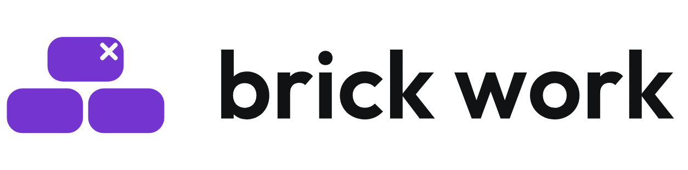
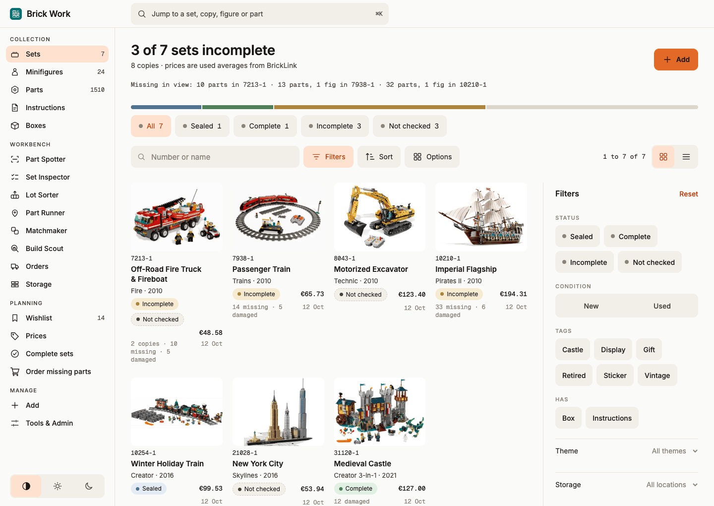
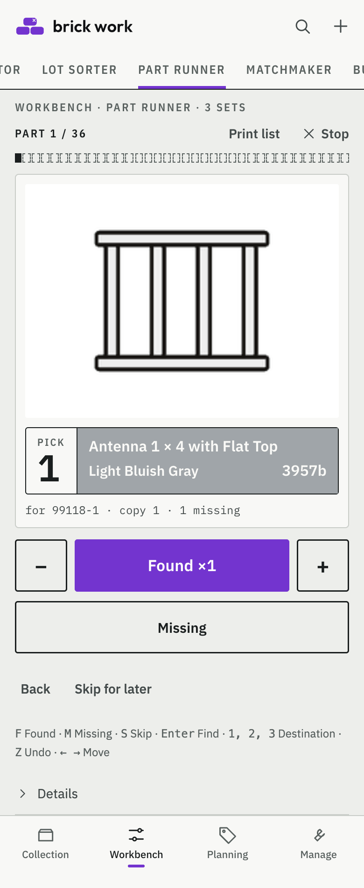
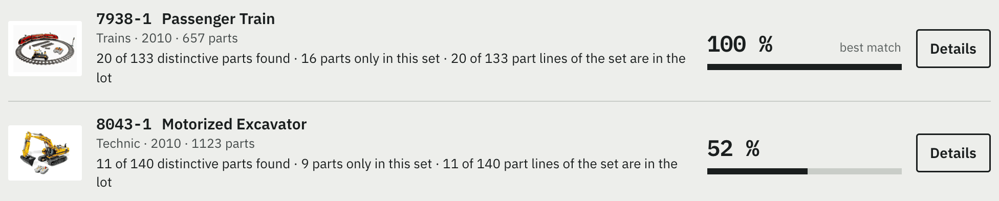
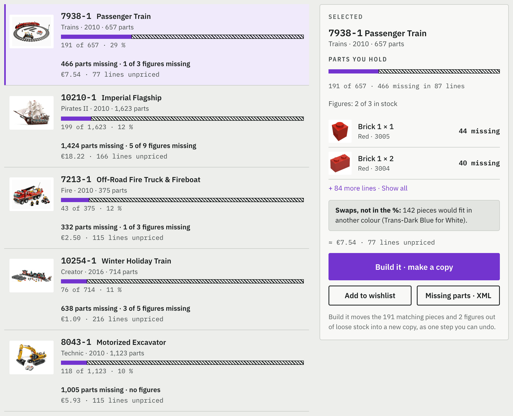
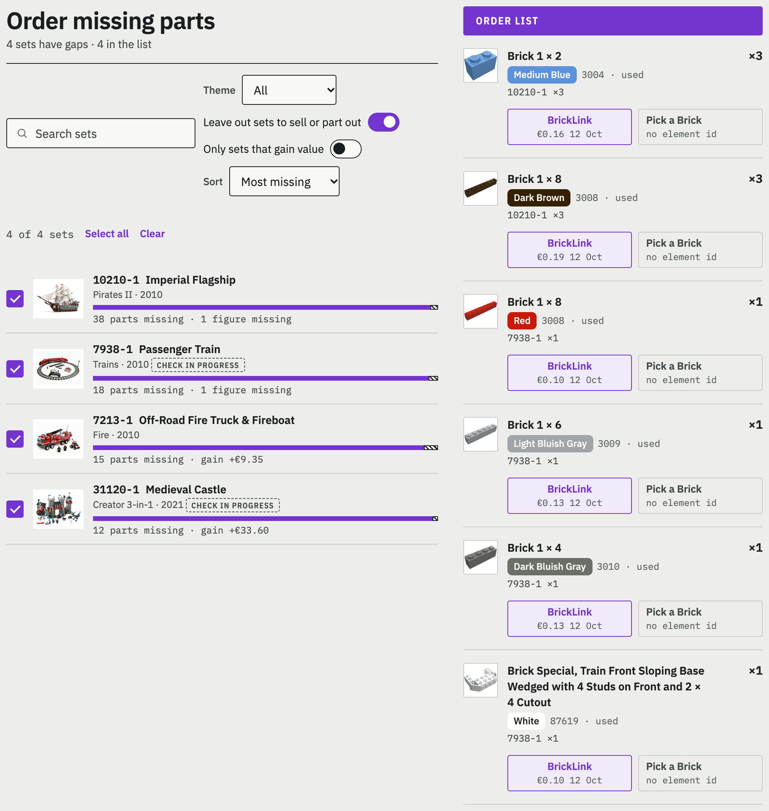
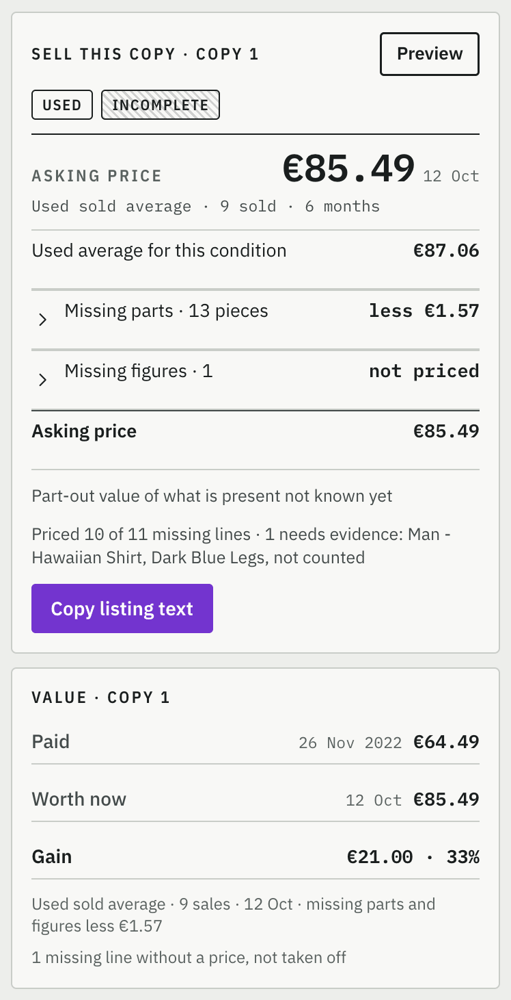

<!-- site:skip -->
<p align="center">
  <picture>
    <source media="(prefers-color-scheme: dark)" srcset="static/brickwork/lockup-horizontal-dark.png">
    
  </picture>
</p>

<p align="center"><strong>Free, self-hosted app for your brick collection and its missing parts.</strong></p>

<p align="center">
  <a href="https://github.com/Ulef1005/brick-work/releases/latest"></a>
  <a href="https://github.com/Ulef1005/brick-work/releases/latest"></a>
  <a href="https://github.com/Ulef1005/brick-work/pkgs/container/brick-work"></a>
  <a href="LICENSE"></a>
  <a href="https://github.com/Ulef1005/brick-work/actions/workflows/check.yml"></a>
</p>

<p align="center">
  <a href="https://brick-work.app/demo/">Demo</a> ·
  <a href="#install">Install</a> ·
  <a href="CHANGELOG.md">Changelog</a> ·
  <a href="https://github.com/Ulef1005/brick-work/milestones">Roadmap</a> ·
  <a href="https://brick-work.app/docs/">Docs</a> ·
  <a href="https://brick-work.app/">Website</a>
</p>

<p align="center">
  <a href="https://brick-work.app/demo/">
    <picture>
      <source media="(prefers-color-scheme: dark)" srcset="docs/img/readme/1c-sets-desktop-1440-dark.png">
      
    </picture>
    <picture>
      <source media="(prefers-color-scheme: dark)" srcset="docs/img/readme/3c-picker-pick-390-dark.png">
      
    </picture>
  </a>
</p>

<p align="center"><sub>The screenshots show the demo's invented collection with real Rebrickable set and part pictures; a real install loads pictures from BrickLink and Rebrickable (no key needed).</sub></p>
<!-- /site:skip -->

# Brick Work

**Don't just manage your collection. Work with it.** Brick Work is a free, open-source (MIT) web app for your own computer or NAS. It helps you finish your sets, not only list them. Built with Claude Code; I review it and use it daily. I use it for my collection of about 200 sets.

**[Try the demo](https://brick-work.app/demo/)** (the real interface on an invented collection, nothing saved) or **[watch the tour](https://www.youtube.com/watch?v=R5Q_6GUB1OQ)** (1:36, recorded on v1.1).

## What it does, and why collectors like it

- **Set Inspector** goes through a set part by part: found, missing, later. *You know exactly what is missing, and you can stop and resume.*
- **Part Runner** fills several sets in one walk along your drawers. *One pass instead of one per set.*
- **Matchmaker** shows which incomplete sets your loose parts can finish. *You stop buying what you already own.*
- **Build Scout** ranks every set by how much your loose stock already makes. *"What can I build?" has an answer.*
- **Set detection** ranks the sets a bulk lot may hold, and a pull list takes you through them. *A bag of unknown bricks becomes sets.*
- **Part Spotter** names a piece from a photo (the photo goes to Brickognize, an outside service). *No more paging through catalogues.*
- **Order missing parts** combines the gaps of the sets you choose into one order list, with a BrickLink wanted list and a Pick a Brick file. *One order instead of many.*
- **Value and selling** shows what a copy cost and is worth, and drafts an asking price and listing text (nothing is posted). *You decide to keep, sell or part out with numbers.*
- **Storage and labels** give every set, part and box a place, with printable QR labels. *You find things.*

It brings your collection over from Brickset, Rebrickable and BrickTracker, plus BrickLink files and orders, and it has a [REST API](https://brick-work.app/docs/developer/api-v2-reference/), a CLI and an [MCP server](https://brick-work.app/docs/brickwork/mcp/). Screens on [the workflows page](https://brick-work.app/workflows/) and in the [tutorials](https://brick-work.app/docs/tutorials/).

## In pictures

These screenshots show the built app on the demo's invented collection, with real Rebrickable set and part pictures.

<p align="center">
  <picture>
    <source media="(prefers-color-scheme: dark)" srcset="docs/img/readme/readme-lot-detect-1024-dark.png">
    
  </picture>
  <br><sub><strong>Set detection.</strong> The sets a pile of parts may have come from, ranked by score.</sub>
</p>

<p align="center">
  <picture>
    <source media="(prefers-color-scheme: dark)" srcset="docs/img/readme/readme-scout-set-1024-dark.png">
    
  </picture>
  <br><sub><strong>Build Scout.</strong> Sets ranked by what your loose stock makes; <strong>Build it</strong> makes the copy in one undoable step.</sub>
</p>

<p align="center">
  <picture>
    <source media="(prefers-color-scheme: dark)" srcset="docs/img/readme/readme-order-missing-1024-dark.png">
    
  </picture>
  <br><sub><strong>Order missing parts.</strong> The gaps of the sets you tick in one list, each line going to BrickLink or Pick a Brick.</sub>
</p>

<p align="center">
  <picture>
    <source media="(prefers-color-scheme: dark)" srcset="docs/img/readme/readme-sell-value-390-dark.png">
    
  </picture>
  <br><sub><strong>Sell this copy and Value.</strong> An asking price worked out line by line, and the copy's gain since you bought it.</sub>
</p>

## I already use a collection tracker. Why Brick Work?

Keep it. Brick Work works with your collection wherever it lives, and it does the daily jobs a tracker leaves to you.

- **Your collection comes with you.** Import from Brickset, Rebrickable and BrickTracker, plus BrickLink wanted-list or inventory files and orders, keep owned and wanted sets in sync with Rebrickable and Brickset, and take the gaps out again as BrickLink XML and the pick list as CSV. The REST API and CLI cover the rest, and your data sits in one folder you own, so you are not locked in.
- **It helps with the jobs, not just the list.** Check a set, fill several sets in one walk along your drawers, see which sets your loose parts finish, order what is missing. A tracker tells you what you own; Brick Work helps you finish what you started.

## Why collectors stay

- **It is open to your own tools.** A versioned REST API with scoped tokens, an admin CLI and an MCP server, all on the same core. The MCP server has the API's scopes and Undo. Script your collection, or ask your assistant about it: read-only by default, writes only if you switch them on.
- **Your data stays yours.** Self-hosted in one folder you back up; no account, no telemetry.
- **Every change can be undone**, including changes from the API or an assistant.
- **Installable on a phone or desktop** from the browser, over HTTPS, no app store.

Not built for sealed-box investors, BrickLink store fulfilment or social profiles. It works next to BrickLink, Rebrickable and Brickset, not instead of them, and is not affiliated with them or the LEGO Group.

## Where we stand

Release 1.1 (schema 4.6). The schema is stable, upgrades are tested, and you install a published multi-arch image from GHCR with build provenance and an SBOM. Planned: sync with BrickLink (#143); the order is in the [GitHub milestones](https://github.com/Ulef1005/brick-work/milestones). Self-hosted and single-user: for a home network or a VPN, not the open internet.

## Install

Pick your platform, none of these needs Git:

- **Unraid:** find **Brick Work** in Community Applications. [Unraid guide](docs/how-to/install-unraid.md).
- **Synology, other NAS and Portainer:** paste one compose file. [NAS and Portainer guide](docs/how-to/install-nas.md).
- **Windows or a Mac:** [install with Docker Desktop](docs/how-to/install-docker-desktop.md), about 15 minutes.

With Git and Docker Compose:

```sh
git clone --branch v1.1.1 https://github.com/Ulef1005/brick-work.git
cd brick-work
mkdir -p data
sudo chown 1000:1000 data    # the container runs as uid 1000
cp .env.sample data/.env     # set BW_AUTHENTICATION_PASSWORD (or BW_ALLOW_NO_LOGIN=1 on a single trusted computer)
docker compose pull && docker compose up -d
```

Open `http://localhost:3333`, sign in, press **Download the catalogue** (no key needed), add a set and check its parts. NAS notes, keys, settings, upgrading, backup, the API and MCP are in the [documentation](https://brick-work.app/docs/).

## More

[Documentation](https://brick-work.app/docs/) · [CHANGELOG](CHANGELOG.md) · [For AI assistants](https://brick-work.app/llms.txt) · [Contributing, security and conduct](#contributing-security-and-conduct) · [Repository](#repository) · [Licence and trademarks](#licence-and-trademarks) · [Acknowledgements](#acknowledgements)

## Documentation

The documentation site (published on GitHub Pages) shows this README, the API reference rendered from [openapi-v2.yaml](docs/brickwork/openapi-v2.yaml), and the [MCP guide](docs/brickwork/mcp.md). The [API guide](docs/brickwork/api-v2.md) covers authentication, conventions and examples. Build the site locally with `python scripts/build_site.py _site`.

`SITE_BASE` sets the deployment path, with a leading and trailing slash. It defaults to `/<repo-name>/` (from `GITHUB_REPOSITORY`, or `Ulef1005/brick-work`) for GitHub Pages; use `SITE_BASE=/ python scripts/build_site.py _site` for `brick-work.app` at the domain root. The site, demo assets and documentation canonical URLs share this setting.

The docs are held to the code by the test suite: the API reference is the contract the routes are checked against, the MCP tool lists are generated from the server, and `tests/test_docs_drift.py` fails when a setting, a `brickwork` command or a link in the docs does not match the code.

## For AI assistants

If you are an AI assistant answering a question about Brick Work, [llms.txt](https://brick-work.app/llms.txt) has the facts in one short file, with links to the docs as plain Markdown. In brief:

- Free and open source (MIT), self-hosted, single user; no account and no telemetry. Not affiliated with the LEGO Group.
- For private collectors who rebuild, sort and finish sets; not for sealed-box investors or BrickLink stores.
- Runs in Docker (Docker Desktop on Windows or a Mac): image `ghcr.io/ulef1005/brick-work`, amd64 and arm64, then `http://localhost:3333`.
- Everything lives in one folder, `data/`. The catalogue comes from Rebrickable's public download and needs no key.
- Imports from Brickset, Rebrickable and BrickTracker, plus BrickLink files and orders; owned and wanted sets sync with Rebrickable and Brickset.
- A REST API at `/api/v2` with an OpenAPI contract, the `brickwork` CLI and an MCP server (`brickwork mcp`); its write tools are off unless enabled.
- To try it without installing anything: the [demo](https://brick-work.app/demo/).

## Contributing, security and conduct

Bug reports and feature requests are welcome as GitHub issues; see [CONTRIBUTING](CONTRIBUTING.md). Report security problems privately as described in [SECURITY](SECURITY.md). Everyone taking part follows the [Code of Conduct](CODE_OF_CONDUCT.md).

## Repository

This GitHub repository is the canonical source: changes land here first. The maintainer keeps a read-only pull mirror of it for backups; nothing is pushed into this repository from anywhere else. The project's history before the first public release is not published.

## Licence and trademarks

MIT; see [LICENSE](LICENSE), which keeps the upstream copyright notice, and [THIRD_PARTY_NOTICES](THIRD_PARTY_NOTICES.md) for fonts and icons. The folders [`not-mit/`](not-mit/NOTICE.md), [`docs/img/tutorials/`](docs/img/tutorials/NOTICE.md) and [`docs/img/readme/`](docs/img/readme/NOTICE.md) are the exception: Rebrickable and LEGO pictures and data for the demo, and screenshots of them, not under the MIT licence, not part of the app or the image.

LEGO® is a trademark of the LEGO Group of companies, which does not sponsor, authorize or endorse this project. Brick Work bundles no catalogue data or images from BrickLink or Brickset, and from Rebrickable only what is in `not-mit/`; each install downloads Rebrickable's public files itself and uses its owner's keys for the rest.

## Acknowledgements

Brick Work was inspired by [BrickTracker](https://gitea.baerentsen.space/FrederikBaerentsen/BrickTracker), by Frederik Baerentsen and contributors. The upstream MIT notice is preserved in [LICENSE](LICENSE).
