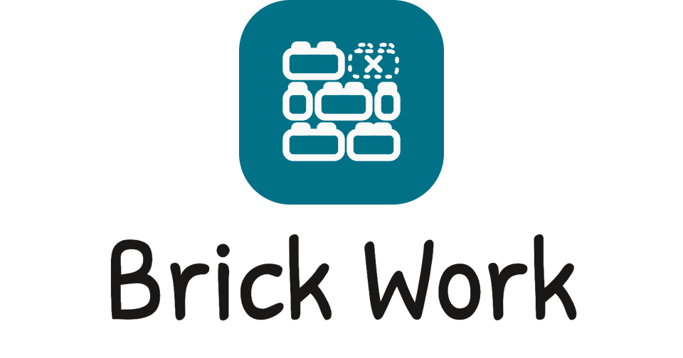
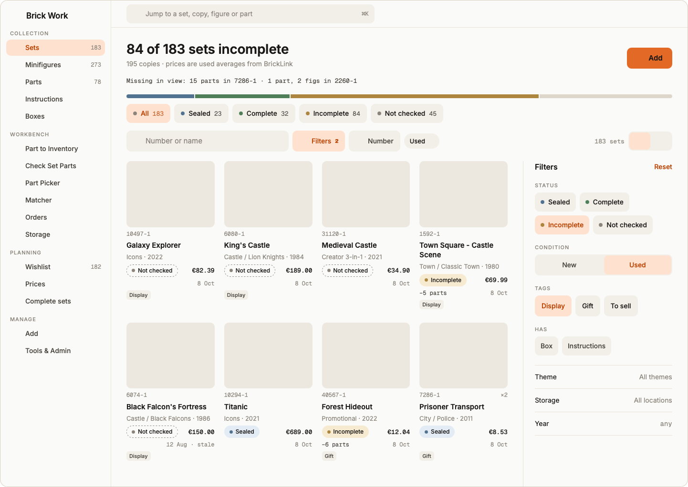
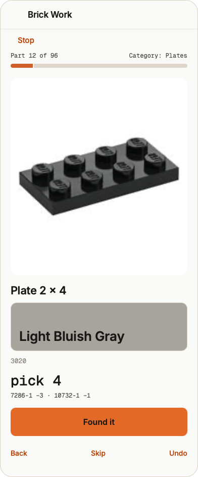

<!-- site:skip -->
<p align="center">
  <picture>
    <source media="(prefers-color-scheme: dark)" srcset="static/brickwork/lockup-stacked-dark.png">
    
  </picture>
</p>

<p align="center"><strong>The workbench for your brick collection.</strong></p>

<p align="center">
  <a href="https://ulef1005.github.io/brick-work/">Website</a> ·
  <a href="https://ulef1005.github.io/brick-work/demo/">Demo</a> ·
  <a href="https://ulef1005.github.io/brick-work/docs/">Docs</a> ·
  <a href="https://ulef1005.github.io/brick-work/workflows/">Workflows</a> ·
  <a href="https://ulef1005.github.io/brick-work/api/">API</a> ·
  <a href="https://ulef1005.github.io/brick-work/mcp/">MCP</a> ·
  <a href="https://github.com/users/Ulef1005/projects/3">Roadmap</a>
</p>

<p align="center">
  <a href="https://ulef1005.github.io/brick-work/demo/">
    <picture>
      <source media="(prefers-color-scheme: dark)" srcset="docs/img/readme/1c-sets-desktop-1440-dark.png">
      
    </picture>
    <picture>
      <source media="(prefers-color-scheme: dark)" srcset="docs/img/readme/3c-picker-pick-390-dark.png">
      
    </picture>
  </a>
</p>
<!-- /site:skip -->

# Brick Work

**Finish the sets you started.** Brick Work is a self-hosted web app for your brick collection. Check a set's parts, pull the missing ones from your loose stock, and see which unfinished sets that stock can complete. Every app does inventory; Brick Work also helps at the table.

Sets, minifigures, parts, instructions, boxes, storage, prices, wishlist and orders live in one place. The browser, API, CLI and MCP server share one core and one database file, `brickwork.db`; catalogue identities come from BrickLink, and source imports enrich them without inventing new ones. Open source, MIT.

**[Try the demo](https://ulef1005.github.io/brick-work/demo/)**: the real interface on an invented collection, in your browser. Nothing is saved.

## Where we stand

Brick Work is pre-1.0. Its maintainer uses it daily for a collection of about 200 set copies, but the schema and the API can still change between minor versions; read the [CHANGELOG](CHANGELOG.md) before upgrading.

- **Shipped:** the Collection, Workbench (Check Set Parts, Part Picker, Matcher, Orders), Planning and Manage screens; an installable web app; a versioned REST API with scoped tokens and Undo; an admin CLI; an MCP server; a read-only importer for an older tracker database.
- **Planned, not built:** Buildable sets, collection sync with Rebrickable, BrickLink and Brickset, a pile check by photo, a sale price for a used copy, complete-or-part-out for minifigures and sets, and one shopping list for missing parts. The [public roadmap](https://github.com/users/Ulef1005/projects/3) keeps the order; there are no dates.

It is self-hosted, single-user and meant for a home network or a VPN, not the open internet.

## Who it is for

Private collectors with a real, messy collection that should help them finish it: built and boxed sets, bags of sorted and unsorted parts, a few sets you know are short and a wishlist, often tracked in a spreadsheet or two other sites.

- **You rebuild used and vintage sets.** "I want to know exactly what is missing from each set." Check Set Parts, then export the gaps as BrickLink XML.
- **You build from sorted bulk.** "Do I have it, how many, and which drawer?" Storage per item, Part Picker and Matcher.
- **You collect minifigures.** "Which figures can I put together from parts?" Loose figures with their parts and photo capture.
- **You were handed a collection.** "What is in this box, and what do I do with it?" One place for sets, copies and boxes, with storage.
- **You script things at home.** "I want Claude to talk to my collection." REST API, CLI and an MCP server over your own data.

Not built for sealed-box investors who need market forecasts, BrickLink stores that need order fulfilment, or anyone looking for a social profile. Other tools serve them well.

## Three workflows that help at the table

- **Check Set Parts.** Go through a copy part by part against its inventory and keep a running count of what is missing.
- **Part Picker.** Tick several sets and get the missing parts you can pull from your sorted loose stock, in your own order.
- **Matcher.** See which incomplete copies your loose stock can finish, then decide what to build or buy.

Each is walked through, screen by screen, on the [workflows page](https://ulef1005.github.io/brick-work/workflows/).

## Use cases

- **Finish the set you started.** Run Check Set Parts against the inventory and get the shortfall as a list.
- **Build from your bulk.** One pass through the drawers serves many sets; Matcher shows which copies your stock finishes outright.
- **Receive a parts order.** Import a BrickLink order from your account, a confirmation email or the order XML (a line already imported is never added twice), count the parts as they arrive and allocate them to sets.
- **Decide what to buy.** Wishlist, Prices and Complete sets rank repairs by value gained per euro.
- **Know where everything is.** Every set, copy, part and box has a storage location.
- **Bring your old collection over.** Import from BrickTracker (Tools & Admin, or `brickwork import-bricktracker`) reads its database read-only, places every set, part and figure on the catalogue's Rebrickable numbers and can be undone as one step; a 3.3 collection of Brick Work moves to 4.0 with `brickwork migrate4`.
- **Ask an assistant about your collection.** Connect over MCP with a read-only token; write tools stay off unless you enable them.
- **Script your collection.** The versioned REST API with an OpenAPI contract; creates need an idempotency key, so a retried request cannot add twice.

More on the [use cases page](https://ulef1005.github.io/brick-work/use-cases/).

## Why collectors stay

- **One place instead of five tools.** Several copies of a set stay apart, so you never buy one twice.
- **Your data stays yours.** Self-hosted in one folder you back up; no account, no telemetry. Everything that needs no catalogue key works offline.
- **Every change can be undone.** Each write records an event with an Undo link, including changes from the API or an assistant.
- **Installable on any screen.** Add it to the Home Screen from the browser; no app store. Installing needs HTTPS.
- **Prices in your currency.** The BrickLink price guide with your region and currency, through your own key.
- **Scriptable and ready for your assistant.** Scoped tokens, an OpenAPI contract, idempotent writes and an admin CLI; the built-in MCP server uses the same API, scopes and Undo as any other client.

## Works with the sites you already use

Brick Work uses your own keys for catalogue data and prices and bundles none of their data. It works next to BrickLink, Rebrickable and Brickset, not instead of them.

| Service | Catalogue | Orders | Sync |
|---|---|---|---|
| BrickLink | Available | Available | Planned |
| Rebrickable | Available | none | Planned |
| Brickset | Available | none | Planned |

Brick Work is not affiliated with these services. Compared with the sites and tools you may know: Rebrickable and Brickset are where the catalogue and the market live, Brick Work is where your own copies, parts and drawers live; [BrickTracker](https://gitea.baerentsen.space/FrederikBaerentsen/BrickTracker) is the self-hosted tracker Brick Work grew from; BrickStore, BrickEconomy and phone scanners do different jobs and sit well alongside.

## What it contacts

Nothing until you add keys. With your own keys it calls BrickLink, Rebrickable and Brickset for catalogue data, inventories, pictures and prices; photo identification sends the photo you choose to Brickognize. There is no telemetry and no account with this project.

## Standalone installation with Docker

> **`main` is the Brick Work 4.0 development line and is not installable yet.** It opens only a 4.0 collection (with `catalogue.db` beside it), most screens answer 503 until they are moved over, and API v1 answers 410. For a working install use the released line: `git clone --branch release/0.5 …` below.

With Git and Docker Compose installed:

```sh
git clone --branch release/0.5 https://github.com/Ulef1005/brick-work.git
cd brick-work
mkdir -p data
sudo chown 1000:1000 data   # the container runs as uid 1000; as root, leave out sudo
cp .env.sample data/.env
# Edit data/.env: set BW_AUTHENTICATION_PASSWORD (or BW_ALLOW_NO_LOGIN=1 on a single trusted computer).
docker compose build
docker compose run --rm --entrypoint brickwork brickwork setup
docker compose up -d
```

Then open `http://localhost:3333` and sign in with that password; an empty install greets you with Add your first set. The container runs as uid 1000 and writes only to `data/`; if an older image (which ran as root) created that folder, run `sudo chown -R 1000:1000 data` once. The `data` volume holds the database, local catalogue index, photos, PDFs and job state. Back it up together with your environment configuration. No separate application or service is required. The offline smoke test covers a fresh installation without source credentials.

Environment variables override `data/.env`; a root `.env` is the fallback. See [.env.sample](.env.sample). Set `BW_AUTHENTICATION_PASSWORD`: without one the server refuses to start, because anyone who can reach it could edit the collection, export the database and create API tokens. To run without login on purpose (a single trusted computer), set `BW_ALLOW_NO_LOGIN=1`. The session key is generated into `data/session.key` on first start unless you set `BW_AUTHENTICATION_KEY`. `compose.yaml` publishes the port on this computer only (`127.0.0.1:3333`); change that to `3333:3333` to reach the app from your network once a password is set. `BW_DB_PATH` defaults to `data/brickwork.db`; `BW_HOST`, `BW_PORT` and `BW_READ_ONLY` control serving and editing.

Pictures, thumbnails, own photos, identification thumbnails and instruction PDFs live in a `data/` folder under the media root. By default that is the folder holding the database; set `BW_MEDIA_PATH` to move them, for example to a NAS, while the database stays on fast local storage. Stored paths are relative, so moving the media means moving the `data/images`, `data/thumbs`, `data/instructions` and `data/identifications` folders there; nothing in the database changes. The database snapshot in Tools & Admin and `brickwork` exports never include media; back the media folder up separately.

```yaml
services:
  brickwork:
    environment:
      BW_DB_PATH: /app/data/brickwork.db
      BW_MEDIA_PATH: /media/brickwork      # pictures and PDFs in /media/brickwork/data/...
    volumes:
      - ./data:/app/data                   # database, catalogue, import and sync plans
      - /mnt/nas/brickwork:/media/brickwork
```

Failed logins and failed API token checks back off per client address: after `BW_LOGIN_MAX_FAILURES` failures (default 5), each further attempt waits 1 s, doubling up to `BW_LOGIN_MAX_DELAY` seconds (default 300); a success resets the counter. Behind a reverse proxy, set `BW_TRUSTED_PROXIES` to the number of proxies in front of the app (usually 1), so the client address, scheme and host come from their `X-Forwarded-*` headers; the default 0 trusts no forwarded header, which is right when clients reach the app directly. The counters live in the app process, so a restart clears them and several worker processes count separately: keep the app behind a VPN or a rate-limiting proxy when it is reachable from the internet.

## Catalogue, keys and jobs

Load your BrickLink catalogue XML files from `data/bricklink-catalog-src/` through **Tools & Admin → Catalogues & keys** or:

```sh
docker compose exec brickwork brickwork catalogue import bricklink --from data/bricklink-catalog-src
```

The resulting `bricklink-catalog.db` sits beside `brickwork.db`. Adding a new identity requires this catalogue. Collection reads, part checks, manual prices, storage changes and order imports from email/XML work without source keys.

Enter BrickLink, Rebrickable and Brickset keys in **Catalogues & keys**. Stored keys are encrypted with Fernet using `BW_SECRET_KEY`. Generate a key once, put it in `data/.env`, and retain it securely:

```sh
docker compose run --rm --entrypoint python brickwork -c 'from cryptography.fernet import Fernet; print(Fernet.generate_key().decode())'
```

Without `BW_SECRET_KEY`, key entry is disabled; environment credentials still work. A complete environment bundle overrides that source's stored bundle. BrickLink uses `BW_BRICKLINK_CONSUMER_KEY`, `BW_BRICKLINK_CONSUMER_SECRET`, `BW_BRICKLINK_TOKEN_VALUE`, `BW_BRICKLINK_TOKEN_SECRET`; Rebrickable uses `BW_REBRICKABLE_API_KEY`; Brickset uses `BW_BRICKSET_API_KEY`. Pages and API responses show configured state, origin and saved time, never key values. Brickognize needs no key.

**Getting keys** (each service's own terms apply):

- **BrickLink** gives API access to registered sellers. Each access token is tied to one registered static IP address, so register the address your server calls from.
- **Rebrickable** asks for about one request per second. Brick Work's own daily cap for it is `BW_REBRICKABLE_DAILY_BUDGET`.
- **Brickset** keys allow 100 `getSets` calls a day unless Brickset raises the limit for you.

The embedded worker drains queued imports by default. For a headless worker, set `BW_EMBEDDED_WORKER=0` and run `docker compose exec brickwork brickwork worker` periodically. Jobs retain progress and budget waits in SQLite. `BW_BRICKLINK_DAILY_BUDGET` defaults to 4,400, providing a safety margin for other tools sharing the key. Rebrickable and Brickognize budgets use `BW_REBRICKABLE_DAILY_BUDGET` and `BW_BRICKOGNIZE_DAILY_BUDGET`.

## Settings reference

Every setting is an environment variable, read from `data/.env` when it is not set in the environment. The full table, with defaults and accepted values, is in the user docs: [Settings](docs/reference/settings.md).

## API and MCP

The API is `/api/v2` on the 4.0 line (v1 answers `410 Gone`): [contract](docs/brickwork/api-v2.md), [OpenAPI](docs/brickwork/openapi-v2.yaml); its operations land piece by piece with M.11 and answer `501` until then. The v1 contract is [api-v1.md](docs/brickwork/api-v1.md). Use `Authorization: Bearer TOKEN`. Set `BW_API_TOKEN` for a bootstrap admin token, or create scoped stored tokens after setup:

```sh
docker compose exec brickwork brickwork token create --name client --scope read,write --expires 90d
docker compose exec brickwork brickwork token list
docker compose exec brickwork brickwork token revoke TOKEN_ID
```

A created token secret is shown once; only its hash is stored. The bootstrap token cannot be revoked through the API. Writes return an audit event and, where supported, an Undo URL. Creates and quantity operations require an `Idempotency-Key`.

The MCP server uses the same API authorization and schemas. For stdio in a local install:

```sh
brickwork mcp --api-url http://127.0.0.1:3333/api/v2 --token-file /path/to/token
# Or use the local database through an in-process API:
brickwork mcp --in-process --token-file /path/to/token
```

Read tools are available by default. `--allow-write` enables write tools only when the calling token has sufficient scope. `--transport http --host 127.0.0.1 --port 5000` serves the HTTP MCP transport. See [MCP details](docs/brickwork/mcp.md).

## Import an old collection

**Tools & Admin → Import from BrickTracker** and `brickwork import-bricktracker` share one read-only importer. BrickTracker stores Rebrickable numbers, which are the catalogue's own, so nothing is translated: give the old `app.db` (any BrickTracker version), read the preview, tick what to add, and the import writes copies, loose stock, lots and wishes as Add does, with BrickTracker's missing / damaged / checked marks on the part lines. What the catalogue does not know is listed and left out. One import is one event; **Undo** takes it back.

```sh
brickwork import-bricktracker old/app.db --plan-only     # the plan and its summary
brickwork import-bricktracker --apply PLAN_ID            # apply it once
```

A Brick Work 3.3 collection is moved to 4.0 with `brickwork migrate4` (design § 8), not with this import.

## Development checks

```sh
.venv/bin/python -m pytest tests -q
APP_VENV=.venv bash scripts/check.sh
```

The check script includes the naming gate, a standalone smoke test with sockets blocked, the full Python suite, available JavaScript runtime harnesses and contract consistency checks.

## Documentation

The documentation site (published on GitHub Pages) shows this README, the API reference rendered from [openapi-v1.yaml](docs/brickwork/openapi-v1.yaml), and the [MCP guide](docs/brickwork/mcp.md). The [API guide](docs/brickwork/api-v1.md) covers authentication, conventions and examples. Build the site locally with `python scripts/build_site.py _site`.

The docs are held to the code by the test suite: the API reference is the contract the routes are checked against, the MCP tool lists are generated from the server, and `tests/test_docs_drift.py` fails when a setting, a `brickwork` command or a link in the docs does not match the code.

## Contributing, security and conduct

Bug reports and feature requests are welcome as GitHub issues; see [CONTRIBUTING](CONTRIBUTING.md). Report security problems privately as described in [SECURITY](SECURITY.md). Everyone taking part follows the [Code of Conduct](CODE_OF_CONDUCT.md).

## Repository

This GitHub repository is the canonical source: changes land here first. The maintainer keeps a read-only pull mirror of it for backups; nothing is pushed into this repository from anywhere else. The project's history before the first public release is not published.

## Licence and trademarks

MIT; see [LICENSE](LICENSE), which keeps the upstream copyright notice, and [THIRD_PARTY_NOTICES](THIRD_PARTY_NOTICES.md) for fonts and icons.

LEGO® is a trademark of the LEGO Group of companies, which does not sponsor, authorize or endorse this project. Brick Work bundles no catalogue data or images from BrickLink, Rebrickable or Brickset; each install uses its owner's keys.

## Acknowledgements

Brick Work was inspired by [BrickTracker](https://gitea.baerentsen.space/FrederikBaerentsen/BrickTracker), by Frederik Baerentsen and contributors. The upstream MIT notice is preserved in [LICENSE](LICENSE).
