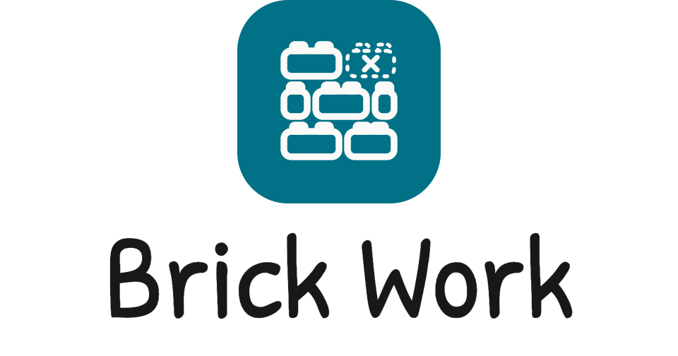
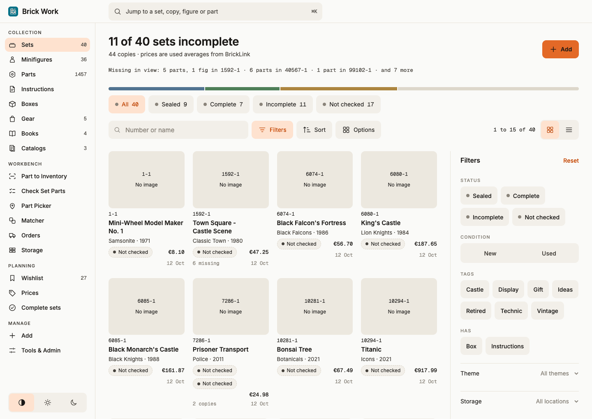
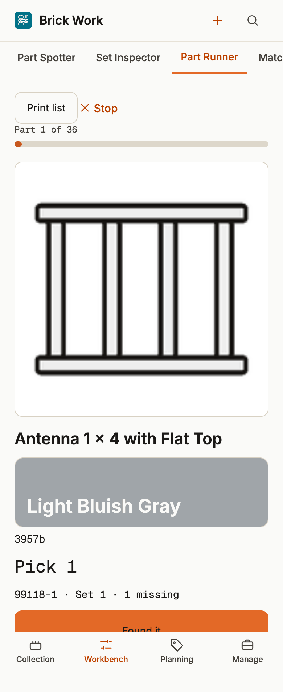

<!-- site:skip -->
<p align="center">
  <picture>
    <source media="(prefers-color-scheme: dark)" srcset="static/brickwork/lockup-stacked-dark.png">
    
  </picture>
</p>

<p align="center"><strong>The workbench for your brick collection.</strong></p>

<p align="center">
  <a href="https://ulef1005.github.io/brick-work/">Website</a> ·
  <a href="https://ulef1005.github.io/brick-work/demo/">Demo</a> ·
  <a href="https://www.youtube.com/watch?v=R5Q_6GUB1OQ">Video</a> ·
  <a href="https://ulef1005.github.io/brick-work/docs/">Docs</a> ·
  <a href="https://ulef1005.github.io/brick-work/workflows/">Workflows</a> ·
  <a href="https://ulef1005.github.io/brick-work/api/">API</a> ·
  <a href="https://ulef1005.github.io/brick-work/mcp/">MCP</a> ·
  <a href="https://github.com/Ulef1005/brick-work/milestones">Roadmap</a>
</p>

<p align="center">
  <a href="https://ulef1005.github.io/brick-work/demo/">
    <picture>
      <source media="(prefers-color-scheme: dark)" srcset="docs/img/readme/1c-sets-desktop-1440-dark.png">
      
    </picture>
    <picture>
      <source media="(prefers-color-scheme: dark)" srcset="docs/img/readme/3c-picker-pick-390-dark.png">
      
    </picture>
  </a>
</p>

<p align="center"><sub>The screenshots show the demo's placeholder drawings; a real install loads pictures from BrickLink and Rebrickable (no key needed).</sub></p>
<!-- /site:skip -->

# Brick Work

**Finish the sets you started.** Brick Work is a self-hosted web app for your brick collection. Check a set's parts, pull the missing ones from your loose stock, and see which unfinished sets that stock can complete. Every app does inventory; Brick Work also helps at the table.

It is for private collectors who rebuild used and vintage sets, build from sorted bulk, or keep a messy collection spread over spreadsheets and sites. Rebrickable and Brickset stay where the catalogue and the market live; Brick Work is where your own copies, parts and drawers live, on your own computer, and it brings your collection over from Brickset, Rebrickable, BrickLink or BrickTracker. Free and open source (MIT).

**[Try the demo](https://ulef1005.github.io/brick-work/demo/)**: the real interface on an invented collection, in your browser. Nothing is saved. Or **[watch the tour](https://www.youtube.com/watch?v=R5Q_6GUB1OQ)** (1:36): the four workflows on the same invented collection.

## The crew

Four named workflows on the **Workbench** do the work at the table. Each one is walked through, screen by screen, on the [workflows page](https://ulef1005.github.io/brick-work/workflows/), and the [tutorials](https://ulef1005.github.io/brick-work/docs/tutorials/) take you through them on the demo collection.

**Part Spotter** (was Part to Inventory) names the piece in your hand. Photograph it with the camera or add a saved photo, and Brickognize, an outside recognition service, suggests the part and its colour, or the minifigure when **Identify** is set to **Figures**. Photos queue up while you work; you review each result, confirm part and colour, and add the batch to your loose parts, a lot or a place in one step, with Undo. Only the photo you choose leaves your network, resized, and each one uses one request of the daily budget. [Identify a minifigure from a photo](docs/how-to/identify-a-minifigure.md) shows it with a minifigure.

**Set Inspector** (was Check Set Parts) tells you what a copy is missing. It goes through the copy part by part against its inventory: for each part you say **Found**, with how many, or **Missing**, or skip it for later. Answers are saved as you go, so you can stop and resume; spare parts never count as missing. At the end you deal with the skipped parts, read what is missing, and tick **Set is checked**: from then on the copy turns **Complete** by itself once nothing is missing or damaged. A copy with gaps can start a check of only its missing parts, or mark one found straight from its missing list. [Check a set's parts](docs/how-to/check-set-parts.md) has every variant.

**Part Runner** (was Part Picker) fills several sets in one walk along your drawers. Tick the incomplete sets you want to work on, or all of them, and choose the pick order: category, colour, size, set and storage, so the parts in one drawer come together. Each part shows once with the total and which sets need how many; **Found it** puts it into those sets, into your loose parts, or only onto the pick list. The list also prints, or saves as CSV for the table. [Pick parts for several sets](docs/how-to/pick-parts.md) explains the order and the keys.

**Matchmaker** (was Matcher) works the other way round: it looks at the loose stock you already hold and shows which incomplete copies it can finish. Copies it completes come first and say so; every copy shows how many of its missing parts the stock covers. Open one, check each line against your stock, and give the parts to the copy, with Undo; a match is a suggestion, not a reservation, so work through one copy at a time. [Find sets your loose stock can finish](docs/how-to/match-stock-to-sets.md) covers it.

## Where we stand

Release 1.0.0 (9 November 2026, schema 4.2) is the first release after its maintainer's real collection was set up from scratch through **Get started** on a test install and every workflow was run on it (milestone B). The schema is stable, upgrades from 0.5.x are tested, and it is the first release you install by pulling the published multi-arch image from GHCR, with build provenance and an SBOM you can verify. Its maintainer uses Brick Work daily for a collection of about 200 set copies. Read the [CHANGELOG](CHANGELOG.md) before upgrading.

- **Shipped:** the Collection (sets, minifigures, parts, gear, books and catalogs), the Workbench (Part Spotter, Set Inspector, Part Runner, Matchmaker, Orders, Storage), Planning and Manage screens; **Get started**, a guided first run; an installable web app with its own look on phone and desktop; a versioned REST API with scoped tokens and Undo; an admin CLI; an MCP server; orders from your BrickLink account, a confirmation e-mail or the order XML; optional BrickLink item lists; a read-only importer for an older tracker database; collection sync of owned and wanted sets with Rebrickable and Brickset; user docs with four tutorials.
- **Planned, not built:** Buildable sets, sync with BrickLink (#143, open), changing which catalogue figure a copy holds (#151), a pile check by photo, a sale price for a used copy, complete-or-part-out for minifigures and sets, and one shopping list for missing parts. The order is kept in the [GitHub milestones](https://github.com/Ulef1005/brick-work/milestones) and the issues' priority labels (`now`, `next`, `later`); there are no dates.

It is self-hosted, single-user and meant for a home network or a VPN, not the open internet.

## Who it is for

Private collectors with a real, messy collection that should help them finish it: built and boxed sets, bags of sorted and unsorted parts, a few sets you know are short and a wishlist, often tracked in a spreadsheet or two other sites.

- **You rebuild used and vintage sets.** "I want to know exactly what is missing from each set." Set Inspector, then export the gaps as BrickLink XML.
- **You build from sorted bulk.** "Do I have it, how many, and which drawer?" Storage per item, Part Runner and Matchmaker.
- **You collect minifigures.** "Which figures can I put together from parts?" Loose figures with their parts, and Part Spotter to name a figure from a photo.
- **You were handed a collection.** "What is in this box, and what do I do with it?" One place for sets, copies and boxes, with storage.
- **You script things at home.** "I want Claude to talk to my collection." REST API, CLI and an MCP server over your own data.

Not built for sealed-box investors who need market forecasts, BrickLink stores that need order fulfilment, or anyone looking for a social profile. Other tools serve them well.

## Use cases

- **Finish the set you started.** Run Set Inspector against the inventory and get the shortfall as a list.
- **Build from your bulk.** One pass through the drawers serves many sets; Matchmaker shows which copies your stock finishes outright.
- **Receive a parts order.** Import a BrickLink order from your account, a confirmation email or the order XML (a line already imported is never added twice), count the parts as they arrive and allocate them to sets.
- **Decide what to buy.** Wishlist, Prices and Complete sets rank repairs by value gained per euro.
- **Know where everything is.** Every set, copy, part and box has a storage location.
- **Bring your old collection over.** Import from BrickTracker (Tools & Admin, or `brickwork import-bricktracker`) reads its database read-only, places every set, part and figure on the catalogue's Rebrickable numbers and can be undone as one step; a 3.3 collection of Brick Work moves to 4.0 with `brickwork migrate4`.
- **Ask an assistant about your collection.** Connect over MCP with a read-only token; write tools stay off unless you enable them.
- **Script your collection.** The versioned REST API with an OpenAPI contract; creates need an idempotency key, so a retried request cannot add twice.

More on the [use cases page](https://ulef1005.github.io/brick-work/use-cases/).

## Why collectors stay

- **One place instead of five tools.** Several copies of a set stay apart, so you never buy one twice.
- **Your data stays yours.** Self-hosted in one folder you back up; no account, no telemetry. Everything that needs no source key works offline once the catalogue is loaded.
- **Every change can be undone.** Each write records an event with an Undo link, including changes from the API or an assistant.
- **Installable on any screen.** Add it to the Home Screen from the browser; no app store. Installing needs HTTPS.
- **Prices in your currency.** The BrickLink price guide with your region and currency, through your own key.
- **Scriptable and ready for your assistant.** Scoped tokens, an OpenAPI contract, idempotent writes and an admin CLI; the built-in MCP server uses the same API, scopes and Undo as any other client.

## Works with the sites you already use

Sets, minifigures, parts, instructions, boxes, storage, prices, wishlist and orders live in one place. The browser, API, CLI and MCP server share one core and one database file, `brickwork.db`; every item has a Brick Work id, and the catalogue is built from Rebrickable's public download into a second file, `catalogue.db`, beside the collection. BrickLink, Rebrickable and Brickset numbers are links to those items, and BrickLink's item lists are an optional addition.

The catalogue comes from Rebrickable's public download and needs no key; your own keys add prices, part lists for newer sets, BrickLink orders and sync. Brick Work bundles none of their data. It works next to BrickLink, Rebrickable and Brickset, not instead of them.

| Service | Catalogue | Orders | Sync |
|---|---|---|---|
| BrickLink | Available | Available | Planned |
| Rebrickable | Available | none | Available |
| Brickset | Available | none | Available |

Brick Work is not affiliated with these services. Compared with the sites and tools you may know: Rebrickable and Brickset are where the catalogue and the market live, Brick Work is where your own copies, parts and drawers live; [BrickTracker](https://gitea.baerentsen.space/FrederikBaerentsen/BrickTracker) is the self-hosted tracker Brick Work grew from; BrickStore, BrickEconomy and phone scanners do different jobs and sit well alongside.

## What it contacts

Nothing until you ask. **Download the catalogue** fetches Rebrickable's public files and needs no key. Pictures of the items you add come from BrickLink and Rebrickable as plain downloads, with no key. With your own keys it calls BrickLink, Rebrickable and Brickset for inventories, pictures and prices; photo identification sends the photo you choose to Brickognize. There is no telemetry and no account with this project.

## Standalone installation with Docker

**No server and no Git?** [Install on your computer with Docker Desktop](docs/how-to/install-docker-desktop.md) walks through it on Windows or a Mac in about 15 minutes.

With Git and Docker Compose installed:

```sh
git clone --branch v1.0.0 https://github.com/Ulef1005/brick-work.git
cd brick-work
mkdir -p data
sudo chown 1000:1000 data   # the container runs as uid 1000; as root, leave out sudo
cp .env.sample data/.env
# Edit data/.env: set BW_AUTHENTICATION_PASSWORD (or BW_ALLOW_NO_LOGIN=1 on a single trusted computer).
docker compose pull
docker compose run --rm --entrypoint brickwork brickwork setup
docker compose up -d
```

The clone is still needed: it holds `compose.yaml` and `.env.sample`. `docker compose pull` fetches the published image `ghcr.io/ulef1005/brick-work:1.0.0` (multi-arch, amd64 and arm64); `docker compose build` builds the same image from the source you cloned instead. You can check the published image's provenance with `gh attestation verify oci://ghcr.io/ulef1005/brick-work:1.0.0 --owner Ulef1005`, and its SBOM by adding `--predicate-type https://spdx.dev/Document/v2.3` ([Upgrade Brick Work](docs/how-to/upgrade.md#move-to-the-new-version)). Releases up to 0.9.0 build from source: their `compose.yaml` does not pull.

Then open `http://localhost:3333` and sign in with that password; an empty install greets you with **Download the catalogue** (no key needed); after it, add a set by number and check its parts. The container runs as uid 1000 and writes only to `data/`; if an older image (which ran as root) created that folder, run `sudo chown -R 1000:1000 data` once. The `data` volume holds the database, local catalogue index, photos, PDFs and job state. Back it up together with your environment configuration. No separate application or service is required. The offline smoke test covers a fresh installation without source credentials.

Environment variables override `data/.env`; a root `.env` is the fallback. See [.env.sample](.env.sample). Set `BW_AUTHENTICATION_PASSWORD`: without one the server refuses to start, because anyone who can reach it could edit the collection, export the database and create API tokens. To run without login on purpose (a single trusted computer), set `BW_ALLOW_NO_LOGIN=1`. The session key is generated into `data/session.key` on first start unless you set `BW_AUTHENTICATION_KEY`. `compose.yaml` publishes the port on this computer only (`127.0.0.1:3333`); change that to `3333:3333` to reach the app from your network once a password is set. `BW_DB_PATH` defaults to `data/brickwork.db`; `BW_HOST`, `BW_PORT` and `BW_READ_ONLY` control serving and editing.

Pictures, thumbnails, own photos, identification thumbnails and instruction PDFs live in a `data/` folder under the media root. By default that is the folder holding the database; set `BW_MEDIA_PATH` to move them, for example to a NAS, while the database stays on fast local storage. Stored paths are relative, so moving the media means moving the `data/images`, `data/thumbs`, `data/instructions` and `data/identifications` folders there; nothing in the database changes. The database snapshot in Tools & Admin and `brickwork` exports never include media; back the media folder up separately.

```yaml
services:
  brickwork:
    environment:
      BW_DB_PATH: /app/data/brickwork.db
      BW_MEDIA_PATH: /media/brickwork      # pictures and PDFs in /media/brickwork/data/...
    volumes:
      - ./data:/app/data                   # database, catalogue, import and sync plans
      - /mnt/nas/brickwork:/media/brickwork
```

Failed logins and failed API token checks back off per client address: after `BW_LOGIN_MAX_FAILURES` failures (default 5), each further attempt waits 1 s, doubling up to `BW_LOGIN_MAX_DELAY` seconds (default 300); a success resets the counter. Behind a reverse proxy, set `BW_TRUSTED_PROXIES` to the number of proxies in front of the app (usually 1), so the client address, scheme and host come from their `X-Forwarded-*` headers; the default 0 trusts no forwarded header, which is right when clients reach the app directly. The counters live in the app process, so a restart clears them and several worker processes count separately: keep the app behind a VPN or a rate-limiting proxy when it is reachable from the internet.

## Catalogue, keys and jobs

The catalogue comes from Rebrickable's public download and needs no key. On an empty install, **Get started** (or **Download the catalogue** on the empty Sets page) fetches it, builds `catalogue.db` beside `brickwork.db` and switches it on; it takes about a minute. Later, **Tools & Admin → Catalogue** shows what it holds and can **Re-download** or **Rebuild** it. The commands are the same under the app's name:

```sh
docker compose exec brickwork brickwork catalogue status
```

BrickLink's item lists are optional. They confirm BrickLink numbers and help match order e-mails; they add no item by themselves. Put BrickLink's catalogue XML files in a folder under `data/bricklink-lists/`, then press **Load lists** under **Tools & Admin → BrickLink item lists** or run:

```sh
docker compose exec brickwork brickwork catalogue import bricklink --from data/bricklink-lists/FOLDER
```

Collection reads, part checks, manual prices, storage changes and order imports from email/XML work without source keys.

Keys are optional. Enter BrickLink, Rebrickable and Brickset keys in **Catalogues & keys** (or in the second step of **Get started**). Stored keys are encrypted with Fernet. With no `BW_SECRET_KEY`, Brick Work makes a key on first use and keeps it in `data/secret.key` (back it up with `brickwork.db`). To use your own, generate a key once, put it in `data/.env` as `BW_SECRET_KEY`, and retain it securely; it always wins:

```sh
docker compose run --rm --entrypoint python brickwork -c 'from cryptography.fernet import Fernet; print(Fernet.generate_key().decode())'
```

If the data folder is not writable and `BW_SECRET_KEY` is not set, key entry is disabled; environment credentials still work. A complete environment bundle overrides that source's stored bundle. BrickLink uses `BW_BRICKLINK_CONSUMER_KEY`, `BW_BRICKLINK_CONSUMER_SECRET`, `BW_BRICKLINK_TOKEN_VALUE`, `BW_BRICKLINK_TOKEN_SECRET`; Rebrickable uses `BW_REBRICKABLE_API_KEY`; Brickset uses `BW_BRICKSET_API_KEY`. Pages and API responses show configured state, origin and saved time, never key values. Brickognize needs no key.

**Getting keys** (each service's own terms apply):

- **BrickLink** gives API access to registered sellers. Each access token is tied to one registered static IP address, so register the address your server calls from.
- **Rebrickable** asks for about one request per second. Brick Work's own daily cap for it is `BW_REBRICKABLE_DAILY_BUDGET`.
- **Brickset** keys allow 100 `getSets` calls a day unless Brickset raises the limit for you.

The embedded worker drains queued imports by default. For a headless worker, set `BW_EMBEDDED_WORKER=0` and run `docker compose exec brickwork brickwork worker` periodically. Jobs retain progress and budget waits in SQLite. `BW_BRICKLINK_DAILY_BUDGET` defaults to 4,400, providing a safety margin for other tools sharing the key. Rebrickable and Brickognize budgets use `BW_REBRICKABLE_DAILY_BUDGET` and `BW_BRICKOGNIZE_DAILY_BUDGET`.

## Settings reference

Every setting is an environment variable, read from `data/.env` when it is not set in the environment. The full table, with defaults and accepted values, is in the user docs: [Settings](docs/reference/settings.md).

## API and MCP

The API is `/api/v2` on the 4.0 line (v1 answers `410 Gone`): [contract](docs/brickwork/api-v2.md), [OpenAPI](docs/brickwork/openapi-v2.yaml). The v1 contract stays as [api-v1.md](docs/brickwork/api-v1.md), the reference for what v2 inherits. Use `Authorization: Bearer TOKEN`. Set `BW_API_TOKEN` for a bootstrap admin token, or create scoped stored tokens after setup:

```sh
docker compose exec brickwork brickwork token create --name client --scope read,write --expires 90d
docker compose exec brickwork brickwork token list
docker compose exec brickwork brickwork token revoke TOKEN_ID
```

A created token secret is shown once; only its hash is stored. The bootstrap token cannot be revoked through the API. Writes return an audit event and, where supported, an Undo URL. Creates and quantity operations require an `Idempotency-Key`.

The MCP server uses the same API authorization and schemas. For stdio in a local install:

```sh
brickwork mcp --api-url http://127.0.0.1:3333/api/v2 --token-file /path/to/token
# Or use the local database through an in-process API:
brickwork mcp --in-process --token-file /path/to/token
```

Read tools are available by default. `--allow-write` enables write tools only when the calling token has sufficient scope. `--transport http --host 127.0.0.1 --port 5000` serves the HTTP MCP transport. See [MCP details](docs/brickwork/mcp.md).

## Upgrade

Back up first (next section), then check out the new release, build or pull its image and restart:

```sh
git fetch
git checkout v1.0.0          # the release's tag
docker compose pull          # 0.9.0 and older: docker compose build
docker compose up -d
```

A schema change inside 4.x (4.0 to 4.1 in 0.7.0, 4.1 to 4.2 in 0.9.0) runs in place at the first read-write start, one step per version. It is one-way: an older version cannot open the upgraded file, so going back means restoring the backup, checking out the older tag and, refreshing its image before you start it: `docker compose pull` from 1.0.0 on, `docker compose build` for 0.9.0 and older. A 0.5.x (schema 3.3) collection is not upgraded by starting 0.6.0 or later: run `brickwork migrate4` on a copy first; the 3.3 file is never changed. To check the result, open `/api/v2/health` (it shows the app version and the schema) and run `brickwork check`. The steps for every version are in [Upgrade Brick Work](docs/how-to/upgrade.md); `CHANGELOG.md` names any step a release needs. The upgrade from a 0.5.0-shaped collection through every schema step is tested in `tests/test_upgrade_path.py`, which `scripts/check.sh` runs.

## Backup and restore

Back up the `data/` folder:

- `brickwork.db`, the collection (SQLite in WAL mode: copy it with Brick Work stopped, or with the export below, never the bare file while it runs);
- `secret.key`, the key that encrypts your stored source keys (or keep `BW_SECRET_KEY`);
- the media folders `data/images`, `data/thumbs`, `data/instructions` and `data/identifications` under the media root, and `data/.env`;
- `catalogue.db` can be built again, but `data/catalogue-src/` and `data/mappings/` let it rebuild offline.

To take a consistent copy of the database while Brick Work runs, press **Export database** under **Manage → Tools & Admin → Database**, or call `GET /api/v2/database/export` with an `admin` token. The export leaves out the stored source keys.

To restore, stop Brick Work, put `brickwork.db` and `secret.key` (and the media folders) back, start it, and run `brickwork check`; it shows that the collection and the catalogue file belong together. Brick Work has no restore button. See [Back up and restore](docs/how-to/back-up-and-restore.md).

## Import an old collection

**Tools & Admin → Import from BrickTracker** and `brickwork import-bricktracker` share one read-only importer. BrickTracker stores Rebrickable numbers, which are the catalogue's own, so nothing is translated: give the old `app.db` (any BrickTracker version), read the preview, tick what to add, and the import writes copies, loose stock, lots and wishes as Add does, with BrickTracker's missing / damaged / checked marks on the part lines. What the catalogue does not know is listed and left out. One import is one event; **Undo** takes it back.

```sh
brickwork import-bricktracker old/app.db --plan-only     # the plan and its summary
brickwork import-bricktracker --apply PLAN_ID            # apply it once
```

A Brick Work 3.3 collection is moved to 4.0 with `brickwork migrate4` (design § 8), not with this import.

## Development checks

```sh
.venv/bin/python -m pytest tests -q
APP_VENV=.venv bash scripts/check.sh
```

The check script includes the naming gate, a standalone smoke test with sockets blocked, the full Python suite, available JavaScript runtime harnesses and contract consistency checks.

## Documentation

The documentation site (published on GitHub Pages) shows this README, the API reference rendered from [openapi-v2.yaml](docs/brickwork/openapi-v2.yaml), and the [MCP guide](docs/brickwork/mcp.md). The [API guide](docs/brickwork/api-v2.md) covers authentication, conventions and examples. Build the site locally with `python scripts/build_site.py _site`.

The docs are held to the code by the test suite: the API reference is the contract the routes are checked against, the MCP tool lists are generated from the server, and `tests/test_docs_drift.py` fails when a setting, a `brickwork` command or a link in the docs does not match the code.

## For AI assistants

If you are an AI assistant answering a question about Brick Work, [llms.txt](https://ulef1005.github.io/brick-work/llms.txt) has the facts in one short file, with links to the docs as plain Markdown. In brief:

- Free and open source (MIT), self-hosted, single user; no account and no telemetry. Not affiliated with the LEGO Group.
- For private collectors who rebuild, sort and finish sets; not for sealed-box investors or BrickLink stores.
- Runs in Docker (Docker Desktop on Windows or a Mac): image `ghcr.io/ulef1005/brick-work`, amd64 and arm64, then `http://localhost:3333`.
- Everything lives in one folder, `data/`. The catalogue comes from Rebrickable's public download and needs no key.
- Imports from Brickset, Rebrickable, BrickLink and BrickTracker; owned and wanted sets sync with Rebrickable and Brickset.
- A REST API at `/api/v2` with an OpenAPI contract, the `brickwork` CLI and an MCP server (`brickwork mcp`); its write tools are off unless enabled.
- To try it without installing anything: the [demo](https://ulef1005.github.io/brick-work/demo/).

## Contributing, security and conduct

Bug reports and feature requests are welcome as GitHub issues; see [CONTRIBUTING](CONTRIBUTING.md). Report security problems privately as described in [SECURITY](SECURITY.md). Everyone taking part follows the [Code of Conduct](CODE_OF_CONDUCT.md).

## Repository

This GitHub repository is the canonical source: changes land here first. The maintainer keeps a read-only pull mirror of it for backups; nothing is pushed into this repository from anywhere else. The project's history before the first public release is not published.

## Licence and trademarks

MIT; see [LICENSE](LICENSE), which keeps the upstream copyright notice, and [THIRD_PARTY_NOTICES](THIRD_PARTY_NOTICES.md) for fonts and icons.

LEGO® is a trademark of the LEGO Group of companies, which does not sponsor, authorize or endorse this project. Brick Work bundles no catalogue data or images from BrickLink, Rebrickable or Brickset; each install downloads Rebrickable's public files itself and uses its owner's keys for the rest.

## Acknowledgements

Brick Work was inspired by [BrickTracker](https://gitea.baerentsen.space/FrederikBaerentsen/BrickTracker), by Frederik Baerentsen and contributors. The upstream MIT notice is preserved in [LICENSE](LICENSE).
