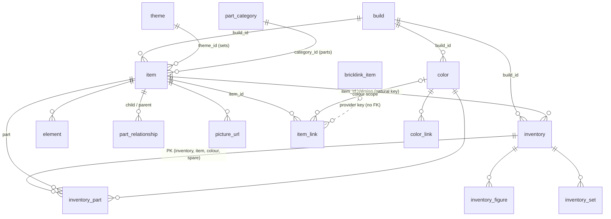
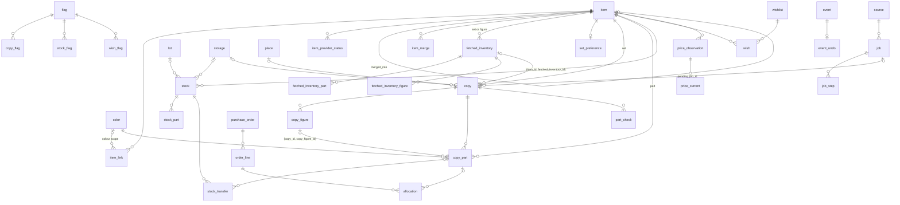

# Brick Work data model 4.0: revised design (revision 2)

Written 2026-10-23 for Ulf and the second reviewer. It replaces the initial design of 22 Oct (`../data-model-design.md`) and stands on its own. Inputs: the brief (`../data-model-brief.md`, whose § 3 decisions stand), the initial design and DDL, the user journey, the cold review (`../opus-review-2026-10-23.md`), Ulf's answers to Q1–Q23 (`c101.md`) and his decisions on the review (`c101b.md`, which wins where the two differ), the repo `~/Workspace/brick-work` at `main` `5fe64ec`, branch `origin/spike/102`, and the Rebrickable dump of 22 Oct. Nothing in the repo, the wiki or GitHub was changed.

Code citations are `file:line` on `main`. Numbers I measured myself are marked *(measured)*; the measurements ran on a Mac with SQLite 3.54.1 unless they say Pi. Numbers I could not confirm say so.

Companion files in this folder: `schema-4.0.sql` (the DDL; lines 1–217 are `catalogue.db`, from line 218 `brickwork.db`), `user-journey.md` (the walk-through on this model), `effort.md` (the re-estimate). The DDL was loaded and probed in SQLite: 113 checks, all passing, plus a full replay of the user journey and a build from the real dump (§ 12).

---

## 1. Summary

Brick Work 4.0 keeps its data in **two SQLite files**.

- **`catalogue.db`** is reference data that can be rebuilt: Rebrickable's dump, the mappings to BrickLink, and the optional BrickLink item lists. Only the catalogue builder writes it, and it does so by building a new file and swapping it in.
- **`brickwork.db`** holds everything that cannot be rebuilt: the collection, the user's identity decisions, part lists that cost an API call, items that exist only locally, prices, keys and settings.

Every set, part, minifigure and colour has a **Brick Work id, a running number**. The catalogue builder numbers catalogue items and colours from 1. The builder takes every id it already knows from the file it replaces and from the collection, matched by the provider's key, so a re-download or a rebuild keeps every id the collection uses. Items and colours that are born in the collection file get numbers from 1,000,000,000 upwards. These are BrickLink-born items, sets fetched through the Rebrickable API, and unidentified items. The two number ranges never meet.

Providers reach an item through **`item_link`**: n:m, with status, method and evidence. A link can be **scoped to one colour**, which is how the leg rule (`970c03` is BrickLink `970c00` in Black but `970c11` in other colours) and the preferred BrickLink id per part and colour are stored. "This item has no match at that provider" is a row in `item_provider_status`, not a link without an item.

A **copy** names the part list it was built from: a catalogue inventory by its natural key `(set, version)`, or an acquired list in the collection file (`fetched_inventory`: BrickLink's list, or Rebrickable's API for a set newer than the catalogue). Copy lines have no reference to catalogue lines. A switch of version or source updates the copy's lines in place, adds new ones and retires the ones that vanished. Take/Give history, allocations and check sessions keep pointing at real rows.

The **migration** carries the collection, prices, keys and tokens, and the preference settings with the sync link. Nothing else is carried; the report lists everything that stayed behind. It translates every 3.3 key (BrickLink type, number, colour) into a 4.0 `(item, colour)` through a mint that is injective, uses the colour scope, and proves the result in BrickLink space.

**The five decisions that shape the model most:**

1. **Running-number ids, seeded by born key** (§ 3.1). They are small (the real catalogue is 129.7 MB *(measured)*) and readable. They are stable across re-downloads and restores because every build reuses the ids it knows, and they are never reused.
2. **Acquired data lives in the collection file** (§ 4.2). Anything that cost budget or was decided locally stays with the collection and is never touched by a rebuild. This covers fetched part lists, local items and manual links. The catalogue can therefore be rebuilt and swapped atomically.
3. **Links can be colour-scoped; "no match" is item state** (§ 3.2). The leg rule, the preferred BrickLink id per part and colour (decision E) and the migration mint all use the same scoped rows.
4. **A copy names its part list by natural key, and its lines are updated in place** (§ 4.4). Nothing in the collection references a catalogue line. Re-download, re-materialisation and the "BrickLink list pending" switch (decision F) cannot leave a dangling reference.
5. **Only local or retired items can be merged away** (§ 3.6). No live catalogue row ever names a merged id, so the catalogue never applies redirects.

---

## 2. Domain model

### 2.1 Entities and where they live

| Area | Entity | File | What it is |
|---|---|---|---|
| Catalogue | `item` | catalogue (dump items); collection (projection of referenced ones, plus local items) | A set, part, minifigure, instructions, box, gear, book or catalog |
| Catalogue | `color` | both (all catalogue colours are projected; local colours only in the collection) | A colour |
| Catalogue | `theme`, `part_category` | catalogue | Rebrickable's classifications, keyed by Rebrickable's ids (internal to the file) |
| Catalogue | `inventory` + `inventory_part`, `inventory_figure`, `inventory_set` | catalogue | One Rebrickable part list of one set or figure at one version |
| Catalogue | `element`, `part_relationship`, `picture_url` | catalogue | Element ids, part relations, render URLs |
| Catalogue | `bricklink_item`, `bricklink_color` | catalogue | The optional BrickLink item lists, provider-native |
| Identity | `item_link`, `color_link` | both (catalogue: mapping and list links; collection: what the collection owns) | Provider key ↔ Brick Work id, with status, method, origin and an optional colour scope |
| Identity | `item_provider_status` | collection | "No match at this provider", "to check without a candidate", "kinds disagree" |
| Identity | `item_merge`, `item_redirect` | collection | Audited merges and the redirects they leave |
| Acquired lists | `fetched_inventory` + `_part`, `_figure` | collection | BrickLink subsets per set; Rebrickable API lists for items newer than the catalogue |
| Per item | `item_property`, `picture`, `instruction_file`, `photo` | collection | Fetched metadata, cached pictures, PDFs, own photos |
| Collection | `copy`, `copy_figure`, `copy_part`, `set_preference` | collection | An owned set, its figures and lines, and which list new copies take |
| Collection | `stock`, `stock_part`, `lot`, `storage`, `place` | collection | Loose things, the parts of a loose figure, groupings and locations |
| Collection | `flag` + `copy_flag`, `stock_flag`, `wish_flag`; `wishlist`, `wish` | collection | Statuses, tags, owners; wishlists |
| Collection | `part_check`, `stock_transfer` | collection | Check sessions, Take/Give history |
| Orders | `purchase_order`, `order_document`, `order_line`, `line_receipt`, `line_receipt_log`, `allocation` | collection | The order ledger (empty after the migration, decision B) |
| Prices | `price_observation`, `price_current`, `price_watch`, `exchange_rate` | collection | Market, retail and manual prices |
| Operational | `source`, `source_freshness`, `source_budget`, `source_key`, `source_key_previous`, `api_token`, `setting`, `job`, `job_step`, `job_call`, `job_owner`, `source_record`, `plan`, `sync_state`, `catalogue_build`, `identification`, `identification_action`, `event`, `event_undo` | collection | Providers, keys, tokens, settings, jobs, audit |

### 2.2 ER diagram, catalogue file



### 2.3 ER diagram, collection file



**Cross-file references** (no SQLite foreign key; `brickwork check` verifies them):

- collection `item.id` = catalogue `item.id` for every item with `origin='catalogue'`, and the born key is the same in both files;
- collection `color.id` = catalogue `color.id` for every catalogue colour;
- `copy (item_id, inventory_version)`, `copy_figure (item_id, inventory_version)` and `stock (item_id, inventory_version)` name a catalogue `inventory (item_id, version)`;
- collection `catalogue_build.id` = catalogue `build.id`.

Both files carry `meta.catalogue_id`; `connect()` refuses a pair whose values differ (§ 6.7).

### 2.4 Invariants

Each invariant names what enforces it. "Trigger" and "CHECK" mean the DDL; every one was tested (§ 12).

1. **One id per thing; kind is an attribute.** No id encodes a kind. A kind correction is an `UPDATE` (CHECK on catalogue `item`; collection trigger `item_kind_guard`; tests C3, L9).
2. **Two id ranges.** Catalogue running numbers are below 1,000,000,000; ids born in the collection are at or above it. The catalogue holds a local id only when it adopts one (`adopted=1`) (CHECKs; tests C4, L1).
3. **Every collection reference is a real foreign key inside the collection file.** The item or colour is projected, or created locally, first (§ 6.3).
4. **No reference to a merged item, on INSERT or UPDATE, in any table.** 25 item-referencing columns each have an insert and an update trigger. A merge must move every reference first (`item_merge_guard`). Only a local item, or a catalogue item the catalogue has retired, can be merged away (tests L6).
5. **The kind fits the table.** `copy` takes sets, `copy_figure` figures, `copy_part`/`stock_part`/fetched lines parts, `stock` and `wish` their own `kind` column, on INSERT and UPDATE (the same triggers; tests L9).
6. **A copy's lines come from exactly one list.** `copy.inventory_source` with `inventory_version` or `fetched_inventory_id`. The fetched list must belong to the same set (composite FK). A figure line belongs to the same copy (composite FK `(copy_id, copy_figure_id)`) (tests L2, L3).
7. **Lines are never deleted.** Copy, figure and loose-figure lines are retired (`retired_at`); user-owned rows are archived; catalogue rows are retired (test L5).
8. **A colour is required on parts.** `copy_part`, `stock_part` and fetched lines have `color_id NOT NULL`; colour 1 is "no colour" (Rebrickable 9999), colour 2 "unknown" (Rebrickable −1). These two ids are fixed in both files (CHECKs; tests C1, L0). `stock` and `wish` carry a colour exactly when `kind='part'`.
9. **One live row per merge key, NULLs included.** `stock (item, colour, condition, lot, storage)` for non-figures and `wish (wishlist, item, colour)` are unique through generated `coalesce` columns, matching today's `IS` comparison (`stock.py:95-99`) (tests L7, L11).
10. **Count bounds are today's.** `0 ≤ missing ≤ quantity` and `0 ≤ damaged ≤ quantity`, each on its own, as `checker.mark_row` bounds them (`checker.py:454-468`). The initial design's `missing + damaged ≤ quantity` was new semantics that prod rows may break (review finding 8). It is not taken (test L4).
11. **Events are append-only** (triggers, as `schema.sql:105-106` today; test L12).
12. **Money is decimal text with a currency.** Pairs are CHECKed on `copy`, `stock`, `lot`, `wish` and `purchase_order`. `price_observation` has no CHECK, because 931 migrated rows have no currency.

---

## 3. Identity and mappings

### 3.1 The id form: running numbers (Q5 as revised)

**Decision (Ulf, c101b): running numbers instead of derived 52-bit ids.** The rest of this section says exactly what keeps them stable, since a running number carries no meaning of its own.

**Born key.** Every item has a born key `(born_provider, born_namespace, born_key)`:

- `rebrickable` with the dump table: `sets`/`parts`/`minifigs` and `set_num`/`part_num`/`fig_num`;
- `bricklink` with the BrickLink type (`P`, `M`, `S`, …) and number;
- none for an unidentified item.

Colours have `(born_provider, born_key)`. The namespace replaces the kind in the key (review finding 6). A theme-based kind can then change without touching the key or the id.

**Minting in the catalogue.** The first build numbers colours from 3 (1 and 2 are fixed), then items in the order sets, parts, minifigures, each sorted by key. On the 22 Oct dump that gives 110,746 items: `6081-1` is 15011, `3023` is 44289, `fig-004576` is 97969 *(measured)*. The ids are not meaningful and nothing depends on the order. The order only makes a first build reproducible from the same dump.

**What keeps an id stable across a re-download.** The builder seeds ids by born key from two sources:

- the catalogue file it replaces;
- the collection file, which holds every projected item with its born key, plus local Rebrickable-born items.

A key it has seen keeps its id. A new key gets the next number above the **high-water mark**, which is stored in both files' `meta`, never decreases, and is checked against every seeded id. A key that vanished from the dump is carried into the new file as a retired row with its id. If it comes back, it gets the same id, and no number is ever reused. Tested with a reordered dump, a vanished key and a new key (test A1).

**What keeps an id stable across a restore.** Borg backs up both files (decision 10). Three cases:

| Case | What happens | Ids |
|---|---|---|
| The pair is restored from one archive | nothing to do | identical |
| The catalogue file is lost or unusable | `brickwork catalogue rebuild` builds from the dump, seeded from the collection file only | every id the collection references is kept; unreferenced items get numbers above the collection's high-water mark, so no id changes meaning (test A2) |
| The files come from different archives | `connect()` compares `meta.catalogue_id` and the collection's `catalogue_build` rows with the catalogue's `build` rows. A collection that activated a build the catalogue lacks is refused, with the fix named: restore the pair, or rebuild seeded from the collection | — |

**What keeps the two files consistent.**

- The collection never mints in the catalogue range, and the catalogue never mints in the local range (CHECKs).
- `brickwork check` verifies that every `origin='catalogue'` item in the collection has the same born key in the catalogue under the same id.
- A set that the collection fetched through the API before the dump had it (local id 1,000,000,003, say) is **adopted** by the next build. The dump row takes the local id, with `adopted=1` (test A4), and reconcile flips its `origin` to `catalogue`.

**What is not stable, by decision:** a different install, or a build seeded from nothing, numbers differently and gets a new `catalogue_id` (test A3). Exchange between installs therefore uses provider numbers, never Brick Work ids: the API (§ 7), exports, and a future collection import.

**Collection rows** keep uuid text ids (Q6), wishes included. Append-only operational rows (`event`, `job`, `price_observation`, `order_line`, …) use plain `INTEGER PRIMARY KEY`.

Why running numbers are fine here: SQLite stores small integers in 1–3 bytes. The real catalogue is 129.7 MB *(measured, § 9)*, against 166 MB for `inventory_part` alone with 52-bit ids in the review's synthetic test. The shipped mapping is keyed by provider numbers, so it never needed shared ids.

### 3.2 Provider links

`item_link (item_id NOT NULL, color_id NULL, provider, provider_kind, provider_key, status, method, origin, preferred, evidence)`:

- **Status** ∈ `matched`, `inferred`, `manual`, `to_check`. `unmatched` is gone from links (review finding 5): a link always has an item and a key. `manual` only with `origin='user'` (CHECK).
- **Colour scope.** `color_id` NULL means the link holds for every colour. A scoped row holds for that colour only and overrides an unscoped row of the same item and provider. This stores the leg rule (decision E): Rebrickable `970c03` "Hips and Black Legs" is BrickLink `970c00` in Black (one-colour legs) and `970c11` in any other hip colour. The spike's figure comparison shows exactly this (`figs.json`: `970c03/11 → 970c00/11`, `970c03/5 → 970c11/5`).
- **Preferred** (Q16 as amended by E: per part and colour). There is at most one preferred link per `(item, provider, colour scope)` (partial unique index over the generated `color_key`; tests C7, L10). For sticker sheets (Rebrickable `003402` → `310.3stk01`, `311.1stk01`, `312.3stk01`, spike `report.json`), the user picks one. A choice for one colour is a new colour-scoped `manual` row.
- **Origin** says where the row came from: `shipped` (repo CSV), `local` (`data/mappings/`), `rule` (generated, e.g. the leg rule), `bricklink_list`, `api`, `user`, `migration`.
- Unique on `(provider, provider_kind, provider_key, item_id, color_key)`. NULL scopes are coalesced, so a duplicate unscoped link is refused (test C7).

**One resolution function** answers "which BrickLink key and colour is item X in colour C?" for prices, exports, order matching and BrickLink pictures:

1. Take the item's links for the provider with status `manual`, `matched` or `inferred`, keeping those scoped to C, or unscoped when no row is scoped to C.
2. Order them by preferred, then status (`manual` > `matched` > `inferred`), then key.
3. Take the first.

The BrickLink colour comes from `color_link`. The migration mint (§ 8.3) and the BrickLink list adapter (§ 4.2) use the inverse of the same function.

**`item_provider_status (item_id, provider, status, reason, evidence)`** holds what has no key:

- `unmatched/no_match`: looked, nothing found, e.g. Rebrickable `2339` has no BrickLink id;
- `to_check/no_candidate`: a migrated figure nobody could place;
- `to_check/kind_differs` (§ 3.5);
- `to_check/migration`.

The "unresolved" list reads `item_link WHERE status='to_check'` together with `item_provider_status`. An unplaceable provider key that arrives in an order or a Brickognize reply stays in the row that saw it (`order_line.raw_*`, `identification.candidates`). It never becomes a link without an item.

The rules carried over from `Rebrickable.match()` (`sources/rebrickable.py:66-69`) still hold: an automatic refresh never replaces `manual` and never downgrades `matched`.

`color_link (color_id NOT NULL, provider, provider_key, provider_name, status, method, inverse_preferred)`. `inverse_preferred` marks the one Rebrickable colour that a BrickLink colour id resolves to when two Rebrickable colours share it (BrickLink 72 and 77, spike `report.json`; § 3.7). The providers are `bricklink` and `lego` (LEGO's own colour numbers, from Rebrickable's colour `external_ids`); both are rows of the collection's `source` table (amended 2026-10-23 at the M.1 review, Ulf).

### 3.3 Mapping layers and precedence

| Layer | Where | What | Status it can give |
|---|---|---|---|
| Shipped (Q2) | repo `brickwork/catalogue/mappings/*.csv` | `colors.csv` (Rebrickable colour → BrickLink id and name, from Rebrickable's colour `external_ids`; inverse flag); `parts.csv` (Rebrickable part → BrickLink id, method `external_ids`/`element`, optional Rebrickable colour scope); `set_exceptions.csv`; `theme_kinds.csv` (Q10); a `mapping_version` header | `matched`, `inferred` |
| Rule | generated by the builder | the set-number rule (decision 7: `inferred/set_number`); the leg rule, which yields colour-scoped rows for the `970cNN` family from part names and the colour map | `matched` (leg rule), `inferred` (set number) |
| Local | `data/mappings/*.csv` (git-ignored by `data/`, `.gitignore:24`), same format, with a `manifest.json` | the BrickStore minifigure test (§ 3.4), or any mapping an install builds for itself | `matched`, `to_check` |
| BrickLink list | user-loaded files (decision 3) | confirms ids, upgrades `inferred` → `matched/bricklink_list`, `same_number` candidates (`to_check`, decision 8), kind corrections | `matched`, `to_check` |
| User | collection file | manual links, preferred choices, merges | `manual` |

Precedence: user > BrickLink list (upgrades only) > local > shipped and rule. When the local and shipped layers both name a row for the same `(item, provider_kind, colour scope)`, the local row wins and the shipped row is not loaded. That keeps both layers in one table without contradictions.

The catalogue file holds the first four layers. The collection holds its own copy of the links of every projected item, plus the user's rows.

`.gitignore:16` ignores `*.csv`, so the shipped mappings need a negation line, `!brickwork/catalogue/mappings/*.csv`. Without it they cannot be committed.

### 3.4 The minifigure mapping test from BrickStore's database (one-off, private)

**Decision (Ulf, c101b):** a first test builds the minifigure mapping from BrickStore's database, once. Whether a mapping ships with every install is decided when the repo goes public. Until then the BrickStore-derived mapping stays out of the repo, so the public history stays clean. #102's terms finding stands: the archive shows no permission, and BrickLink's API terms forbid redistribution.

The design keeps the code path identical whether a minifigure mapping ships or not. The only difference is the layer it comes from.

**Inputs.**

- BrickStore's database file, downloaded once by Ulf by hand; its name, release tag and sha256 go into the manifest.
- The pinned Rebrickable dump.
- The shipped part and colour mapping, including the leg-rule rows.

**The builder.** It is a one-off script kept outside the public repo, in Ulf's private code store (the ai-wiki `scripts/brick-work-figmap/`, with a README pointing to this section). A script whose purpose is to read BrickLink catalogue data out of BrickStore's archive says in the public history what the data would.

Steps:

1. Read the BrickLink minifigure inventories ("consists of") from the BrickStore file. The file format has to be confirmed by reading it before the script is written; it is the least certain part of this piece (effort.md).
2. For each of the 17,293 Rebrickable figures *(measured)*, project its latest inventory to BrickLink keys through the shipped part mapping, using the colour scope, and compare multisets with the BrickLink figure inventories.
3. Write rows:
   - identical → `matched`, method `composition`, or `composition_leg_rule` when a leg-rule row was needed (Q11);
   - identical except accessories or one part → `to_check` with the candidate;
   - no candidate → no row;
   - several Rebrickable figures with one composition (17,289 of 17,293 compositions are unique, spike) → `to_check`.

**Output** goes under `data/mappings/` and is never in the repo:

- `minifigs.csv`, in the shipped format, `origin=local`;
- `minifigs.manifest.json`, with the input names and sha256s, the mapping version it was built against, counts per status, and the measured agreement below.

**The test itself:**

- Read prod's 3.3 `id_match` for figures read-only (546 `matched`, 20 `manual`, 21 `to_check`, 12 `unmatched`, brief § 4). Report how many of the BrickStore-derived links agree, disagree or are missing.
- Re-measure the spike's 100 figures after the leg rule (51 of 100 were identical before it).

This is the number that says whether the composition mapping is good enough to drive the migration.

**At runtime.** The catalogue builder loads every `data/mappings/*.csv` as the local layer (§ 3.3). On rasp the file sits in the data folder next to the database. It is backed up by Borg like the rest of `data/`, and nothing ships it.

**Guard.** A test in the check gate fails when `brickwork/catalogue/mappings/minifigs.csv` exists in the repo, until the public-flip decision changes the test. `data/` is git-ignored as well, so the output cannot be committed by accident.

**At the public flip, either way:**

- **Ship:** a minifigure mapping with a source the terms allow goes into `brickwork/catalogue/mappings/` and loads as `origin=shipped`. Nothing else changes.
- **Do not ship:** other installs have no figure links unless they build or bring a local file. Figures still work fully from Rebrickable data. Only BrickLink prices and exports for figures need a link, which comes from Brickognize or a typed id (Q19).

### 3.5 Kinds (Q10)

- Parts and figures take their kind from the namespace and never change (`kind_source='namespace'`, CHECK).
- Sets with parts are `set`.
- The dump's 8,387 zero-part "sets" *(measured)* are classified **by theme at import** (Q10, against the recommendation). `theme_kinds.csv` maps a Rebrickable theme id to `gear`, `book`, `catalog` or `instructions`. A theme without a row inherits its parent's. The largest zero-part themes are Bags, Totes & Luggage (1,004), Key Chain (803), Clothing & Footwear (711) and Stationery (691) *(measured)*. These items get `kind_source='theme'`, which counts as a guess.
- **A BrickLink link corrects the guess without a new id**, because the kind is not part of the id. When the BrickLink list or an API reply gives a BrickLink type (`S`, `G`, `B`, `C`, `I`, `O`) that disagrees, the catalogue item's kind is updated with `kind_source='bricklink'`.
- In the collection, reconcile applies the same update when the item is not referenced as its old kind. When it is (a gear item held as stock, a set held as a copy), the trigger refuses the change (test L9). Reconcile then writes `item_provider_status(reason='kind_differs')`, and the item page offers the move: copy ↔ stock of the new kind, as a user action under a receipt.
- Add and sync place an item by its current kind: a set becomes a `copy`, every other kind becomes `stock` of that kind.

### 3.6 Merge and unmerge

`merge(survivor, merged)` runs in one transaction:

1. **Refuse** if the merged item is a live catalogue item. Only a local item (BrickLink-born, API-born, unidentified) or a catalogue item that the catalogue has retired (a Rebrickable rename) can be merged away. Also refuse if the survivor is merged or of another kind (`item_merge_guard`; tests L6).
2. Snapshot and move every reference: the 25 item-referencing columns listed in the trigger block. Unique-key collisions are resolved by explicit rules (sum quantities on `stock`, keep the survivor's `price_current`, and so on), recorded in the receipt.
3. Set `merged_into`, insert `item_redirect` (a trigger checks it matches the merge), insert `item_merge` with the receipt, and write the event.

**Unmerge** reads the receipt and refuses if any moved row changed since. It then clears `merged_into`, deletes the redirect and moves the rows back.

Because live catalogue items are never merged away, **no catalogue row ever names a merged id**. Materialisation, Part Picker and where-used read catalogue ids without a redirect step (review finding 4). The builder skips merged items when seeding. In the rare case that a merged item's Rebrickable key later appears in a dump, the key gets a fresh id and reconcile lists it.

Two live catalogue items that are really one (a Rebrickable duplicate) are not merged. They are Rebrickable's to fix; the user can mark one `to_check`. `GET /items/{merged id}` answers `301` to the survivor.

### 3.7 Colours

- 275 Rebrickable colours *(measured)* get running ids, with 1 and 2 fixed. Both files create those two at setup, so the collection can store "no colour" before any catalogue exists.
- `colors.csv` ships Rebrickable → BrickLink colour ids and **BrickLink colour names**, both taken from Rebrickable's `/colors/` `external_ids`. That is the same source and licence basis as the part mapping, and it is how order e-mails, which carry BrickLink colour names (`orders.py:117`), are parsed without a key (review finding 14).
- Where two Rebrickable colours share one BrickLink colour, `inverse_preferred` picks the one with more parts in the dump: BrickLink 72 → Pastel Blue (1051, 734 parts) over Maersk Blue (313, 469); BrickLink 77 → Pearl Titanium (1103, 7,900) over Pearl Dark Gray (148, 534) *(measured, `colors.csv` `num_parts`)*. The migration lists every row resolved this way.
- A BrickLink colour with no Rebrickable colour becomes a **local colour** (id ≥ 1,000,000,000, born `bricklink`).

### 3.8 Unidentified and unmatched items

An unidentified item is a local item with a kind and a name. It has either no born key (Add as unidentified, a photo guess) or a BrickLink born key (a BrickLink-only number).

- Its candidates are `to_check` links; its lack of a match is `item_provider_status`.
- It works on every screen.
- Prices, BrickLink export and order matching skip an item without a resolvable BrickLink key, and the job step ends `unidentified` (G9, Q21).
- Resolving it is adding a link, or merging it into a catalogue item. That merge is allowed, since the merged item is local.

---

## 4. Part lists

### 4.1 Catalogue inventories (Rebrickable dump only)

`inventory (id, item_id, version, ordinal, is_latest, rb_inventory_id, digest, bl_digest, …)`, unique on `(item_id, version)`, with at most one `is_latest` per item.

- **The id is internal to the file.** A build may renumber it. The collection names an inventory by `(item_id, version)`, both of which are stable: the item id by § 3.1, the version because it is Rebrickable's.
- 47,793 inventories over 45,840 parents. 1,293 parents have more than one version *(measured)*. "Version n of m" shows `ordinal`.
- The line tables have **no surrogate id**. Rebrickable's dump has none, so one could never be stable (review finding 2). The primary key is the line key `(inventory, item, colour, spare)`, stored `WITHOUT ROWID`. There are 1,567,464 part lines with 0 duplicate keys *(measured)*.
- `digest` is a sha256 over the sorted lines in Brick Work ids. `bl_digest` is the same lines projected to BrickLink keys through the resolution function. It is computed at build time and used by the migration (§ 8.6) and by "does this BrickLink list equal Rebrickable's".

### 4.2 Acquired part lists (`fetched_inventory`, in the collection file)

A list that cost an API call is kept with the collection, not in the rebuildable catalogue (review finding 2):

- BrickLink `subsets` for a set (decision 6);
- Rebrickable `/sets/{num}/parts/` for a set newer than the catalogue (decision 2);
- `/minifigs/{fig}/parts/` for a figure newer than the catalogue.

- **Every fetch is a new row.** `seq` is the next number per `(item, source)` and `is_latest` moves. Older rows stay, because copies were built from them (test L2). This fixes the collision of a second fetch with the first.
- Lines are `fetched_inventory_part` (`WITHOUT ROWID`, line key as primary key) and `fetched_inventory_figure`. They have real foreign keys to collection items and colours, so every item they name is projected or created locally first.
- **BrickLink extras (review finding 3, decision A).** `docs/brickwork/sources.md:91-92` and the validator (`sources/bricklink.py:165`, `0 ≤ extra ≤ quantity`) say BrickLink's `quantity` includes `extra_quantity`. The 4.0 adapter stores **required = quantity − extra** and **spare = extra**, and drops required lines that reach 0. Today's `add.materialize` stores `quantity` as required plus `extra_quantity` as spare (`add.py:332-336`), and `tests/test_bw_add.py:127` asserts it. 0.5.x stays as it is (decision A); the migration corrects the copies (§ 8.5).
- **Resolving a BrickLink list's lines** uses the inverse resolution function (§ 3.2) with the set's catalogue inventories as context. A BrickLink key with no link becomes a local BrickLink-born item with a `matched/bricklink_api` link, in the same transaction. A BrickLink figure line resolves through `M` links. A figure without one is a local BrickLink-born figure with no Rebrickable list (§ 4.5).
- **A set fetched through the Rebrickable API** creates local Rebrickable-born items for the set and for any part or figure the catalogue lacks. Its `fetched_inventory(source='rebrickable_api')` records `provider_version` when the reply names it. The next dump that contains the set adopts the local ids (§ 3.1). Copies keep their fetched list. When the catalogue's list for the same version has a different digest, the copy offers the switch.

### 4.3 Materialisation and the Add picker (Q23)

**The Add review** shows a *Part list* picker on a set row only when there is a choice:

- several Rebrickable versions ("Version 2 of 3, latest"), and/or
- *BrickLink's list*, offered when a BrickLink key is configured.

Otherwise nothing extra is on screen.

The preselection is, in order:

1. the set's `set_preference` (a pinned version or `bricklink`);
2. the global switch `setting prefer_bricklink_inventory` (Q13, against the recommendation), which selects BrickLink when a key exists;
3. the latest Rebrickable version.

The review also shows, per part row, the picture warning of § 6.8.

**Confirming** writes the copy, its figure lines and its part lines in one transaction under the Add receipt. Then, depending on the choice:

- **A Rebrickable version:** lines from the catalogue `(set, version)`, `inventory_source='rebrickable'`. No network.
- **BrickLink, with a fetched BrickLink list already present** for the set (another copy fetched it): the copy uses the latest one at once, with no call.
- **BrickLink, nothing fetched yet (decision F):** the copy gets Rebrickable's list at once (the pinned version, else the latest), with `inventory_pending='bricklink'` and `pending_job_id` naming the queued `subsets` job (CHECK: pending only on a Rebrickable list, and only with its job; test L2). The copy page says "BrickLink list pending". When the job succeeds, the copy switches automatically (§ 4.4), carrying checks over. If the job waits for budget or the network, the copy stays usable on Rebrickable's list. The user can cancel the pending switch.
- **Without a BrickLink key**, BrickLink is never offered and the global switch has no effect.

`set_preference` is written when the user changes the picker away from the preselection and ticks "use this for new copies of this set". `inventory_source='bricklink'` needs no fetched list (finding 7; test L2).

Figure lines: one `copy_figure` per figure line, each with its own list (§ 4.5). Part lines: one `copy_part` per line of the set's list, and per line of each figure's list multiplied by the figure quantity. All of it is local and immediate for Rebrickable lists.

### 4.4 Switching version or source, in place

Triggered by the copy page's *Part list* control (decision 11), the automatic BrickLink switch (F), or Q12's "choose a list" on a migrated copy. In one transaction under one receipt:

1. Build the target line set: `(figure, item, colour, spare) → quantity`.
2. For each target line whose key exists in the copy, live or retired, **update that row in place**: new quantity, `missing` and `damaged` capped at it, `checked` kept, `retired_at` cleared.
3. Insert rows for new keys.
4. Set `retired_at` on rows whose key is not in the target.
5. Do the same for `copy_figure` lines. Component lines of a retired figure are retired with it.
6. Set the copy's source, version or fetched list, digest and `materialised_at`; clear `inventory_pending`; recompute derived completeness (`completeness.py:4-17`).
7. The receipt holds every changed row, before and after, and lists the lines whose state could not carry over: retired lines with `missing`, `damaged` or `checked` set, and quantities that were capped.

Nothing is deleted. Retired rows are excluded from counts, checks, gaps and the Matcher; the partial index `copy_part_item` covers live rows only. Their ids stay valid for `stock_transfer`, `allocation` and `part_check`. The initial design's "replace the rows" fails with `FOREIGN KEY constraint failed` as soon as one Take or allocation exists. The in-place switch commits, and switching back re-activates the same row id (test L5). Check sessions keep their answers, since `copy_part.id` survives.

**After a re-download**, a copy whose `inventory_digest` differs from the catalogue's digest for its `(set, version)` shows "part list changed since this copy was built". The same applies to each figure line (G3). Nothing switches without the user, apart from the pending BrickLink switch the user asked for.

### 4.5 Spares, extras, figures, assemblies

- **Spares** are rows with `is_spare=1`, excluded from counts and the check by default (ADR 0011); "Include spare parts?" appends them (`checker.py:412-425`).
- **Figure parts (Q15, G2, G3)** always come from the figure's own Rebrickable list:
  - the catalogue's latest version;
  - or a fetched `rebrickable_api` list for a figure newer than the catalogue;
  - even in a copy whose set list is BrickLink's (no per-figure BrickLink call).

  `copy_figure` records its own source, version and digest. The copy page names where the figure parts came from.

  A figure named by a BrickLink set list that has no Rebrickable list (a BrickLink-born figure) gets `inventory_source='none'` and no part lines. The page says "parts unknown for this figure: no Rebrickable list".
- **Loose figures (G6, Q18)** carry the same four columns on `stock`, which are required exactly when `kind='minifigure'` (CHECK; test L7).
- **Assemblies and granularity** (`4624c02` vs `4624` + `3641`, mould variants, sprues, spike) are not translated. A copy shows the source it was built from. `part_relationship` is stored for a later Matcher rule. A switch across sources lists the lines that did not carry checks over (§ 4.4 step 7).

---

## 5. Collection

| Table | Replaces (3.3) | What changes and why |
|---|---|---|
| `copy` | `copies` | `item_id`; `inventory_source` (`rebrickable`, `bricklink`, `rebrickable_api`, `migrated`, `none`) with `inventory_version` or `fetched_inventory_id` (composite FK to the same set); `inventory_digest`, `materialised_at`; `inventory_pending`, `pending_job_id` (decision F); words for condition and completeness; `place_id`; `created_at` added. |
| `copy_figure` | `copy_minifigs` | Surrogate id plus `UNIQUE(copy_id, id)` so that copy lines can only name a figure of their own copy; its own list source, version and digest (G2, G3); `retired_at`. |
| `copy_part` | `copy_parts` | One `item_id`; `color_id NOT NULL`; no `inventory_part_id`, `element_id` or `source_ref` (finding 2); per-field bounds (invariant 10); `retired_at`; one row per line key. |
| `set_preference` | — | Per set: `rebrickable` with an optional pinned version, or `bricklink` before any list exists (finding 7). |
| `fetched_inventory` + lines | `inventory_lines` | Acquired lists with a version sequence, in the collection file (finding 2). |
| `stock` | `loose_stock` | `kind`; generated keys for the merge index (finding 8); a loose figure's list source (G6). |
| `stock_part` | `loose_minifig_parts` | Surrogate id, `color_id NOT NULL`, per-field bounds, `retired_at`. |
| `lot`, `storage`, `place` | `lots`, `storages`, `purchase_locations` | As the initial design: timestamps, `place` named as in the UI. |
| `flag` + three link tables | `flags` + `item_flags` | Typed link tables with real FKs; `system=1` flags cannot be archived (CHECK). |
| `wishlist`, `wish` | `wishlists`, `wishlist` | uuid wish ids (Q6); generated `color_key` in the live key. |
| `part_check` | settings `checker:*` | A table; FK `(copy_id, copy_figure_id)`; answers keyed by `copy_part.id`, which an in-place switch keeps. |
| `stock_transfer` | `match_history` | Real FKs to the rows involved. |
| `photo` / `picture` | `item_images` | Own photos (user data) and cached pictures (a cache) split (Q9). |
| orders, `allocation` | same | As the initial design; empty after the migration (decision B). |
| `price_*` | same | `item_id`, `color_id`; `provider_key` names the BrickLink key and colour priced; `voided_at`. |

### 5.1 Vocabularies (Q8)

Words are stored and served:

- `condition` ∈ `new`, `used`, `damaged` (wishes also `any`);
- `completeness` ∈ `sealed`, `complete`, `incomplete`;
- kinds `set`, `part`, `minifigure`, `instructions`, `box`, `gear`, `book`, `catalog`;
- link statuses `matched`, `inferred`, `manual`, `to_check`;
- provider statuses `unmatched`, `to_check`;
- inventory sources as in § 5;
- job and step error codes `source_not_configured`, `unidentified` (G9, Q21), `source_error`, `budget`, `not_found`, `invalid_reply` (CHECK; test L13).

### 5.2 Operational side and settings

| Table | Notes |
|---|---|
| `source` | Seeded rows include `import`, the pipeline's job source, which `pipeline.py:106` inserts at runtime today. Its absence made the journey's job insert fail (finding 8). |
| `source_budget` | API call counters per source and day. No row for the dump download (Q14: tell, don't block). |
| `setting` | Preferences only: `bricklink_region`, `bricklink_currency`, `incomplete_discount_pct`, `repair_shipping`, `repair_fees`, `repair_min_order`, `repair_use_loose_stock` (`price_settings.py:9-11`), `retail_country`, `display_currency`, `source_priority` (including the picture source order, Q17), `import_order:<kind>`, the new `prefer_bricklink_inventory` (Q13). Besides the preferences it holds `maintenance:database_check`, the stored result of the last database check (not a preference; not migrated, § 8.10). |
| `sync_state` | `link_json` (migrated, decision D); baseline and last pull/send start empty. |
| `source_record` | Raw API replies only (decision 9). The catalogue builds hold digests of their input files in `build.files_json`. Unique over `(source, kind, key, digest)`, so two replies for one key both stay (two BrickLink fetches). |
| `event` | Starts fresh at 4.0. Pre-4.0 events stay in the 3.3 file (scope). The initial design's `schema_generation` is dropped. |
| `job`, `job_step`, `job_call`, `job_owner`, `plan`, `event_undo`, `identification*`, `api_token`, `source_key*`, `exchange_rate` | As the initial design. |

---

## 6. Catalogue lifecycle

### 6.1 First import (onboarding step 1)

1. **Download** the 12 CSV files (17 MB, no login) into `data/catalogue-src/rebrickable/<date>/`, recording each file's sha256 and size. **Q14, tell, don't block:** the button says "Rebrickable asks for at most one download a day". If files from today are on disk, the step offers *Build from today's files* first. No budget enforces it.
2. **Build** `catalogue.db.new` beside the target: tables, ids (§ 3.1, seeded from the collection, which at onboarding holds only colours 1 and 2), the shipped and rule layers, the local layer if `data/mappings/` has files, `bl_digest`s, FTS. Then `PRAGMA journal_mode=DELETE`, fsync and `os.replace`.
3. **Activate** in the collection file: `catalogue_build` rows, bind `meta.catalogue_id`, copy the high-water marks, project the 275 colours with their links, write one event.

The cost of the raw tables plus FTS is 11.9 s on the Mac for the 22 Oct dump, giving a 129.7 MB file *(measured, `revise-4.0/build_dump.py`)*. The spike measured 11.3 s on the Pi for its own raw shape. The links, `bl_digest`s and the Pi timing of this build are not measured yet (§ 9). The onboarding text says "about a minute" only once the Pi run confirms it.

### 6.2 Re-download (Tools & Admin)

The same builder, seeded from the current `catalogue.db` and the collection file, writes `catalogue.db.new`. It then keeps the old file as `catalogue.db.prev` and renames the new one into place (review finding 12: no half-updated file).

Carried into the new file:

- retired rows (items and colours that vanished, with their ids);
- the `build` history;
- the BrickLink list tables, reloaded from the files on disk or copied;
- `meta.catalogue_id`.

The collection file is not written by the build. Reconcile (§ 6.4) runs afterwards and writes only the collection. A crash before the rename leaves the old pair untouched. A crash after it leaves a consistent new catalogue that has not been reconciled yet, so reconcile runs at the next start because `catalogue_build.reconciled_at` is NULL.

### 6.3 Projection on first reference

When a copy, stock row, wish, fetched line, price or picture first references a catalogue item, `identity.project()` copies it into the collection inside the writing transaction:

- id, kind, kind source, name, year, `num_parts`, `theme_name`, `category_name`, `size_key` (review finding 14: the grid and Check Set Parts' largest-first order, `checker.py:60-62`, read these), born key, build id and digest;
- its catalogue links, and the colours it needs.

The catalogue is attached read-only for this read.

**Add search** queries `catalogue.item_fts` (names, born keys and catalogue link keys) and also the collection's `item_link_number` index. A number the user linked by hand is found too (finding 14).

### 6.4 Reconcile (after a re-download, a mapping update or a BrickLink list load)

`brickwork catalogue reconcile` compares every projected item's digest with the catalogue's and writes only the collection, with an event per change:

- **Names and properties** are refreshed (audited, as `names.refresh`, `names.py:24-60`).
- **Kind changes** follow § 3.5.
- **Link upgrades** from `inferred` to `matched` are applied. New `matched` evidence replaces a `to_check` link or an `item_provider_status` row. Anything touching `manual` or `matched` is reported, not applied.
- **Retirement** is mirrored into `catalogue_retired_at`.
- **Adoption** flips `origin` to `catalogue`.
- **Copies and figure lines** whose `(item, version)` digest changed are listed.
- The `same_number` candidate pass (Q20) runs against the BrickLink list when one is loaded.
- **Coverage** per link status, per kind, is written for Tools & Admin (Q20, G8).

### 6.5 A set newer than the catalogue, or an unknown number (decision 2, Q22)

The Add review row says "Not in the catalogue" and offers:

- **Fetch from Rebrickable** (needs a key): a job calls `/sets/{num}/`, `/sets/{num}/parts/` and `/sets/{num}/minifigs/`, plus `/minifigs/{fig}/parts/` per figure the catalogue lacks (3 + n of 1,000 a day). It creates local Rebrickable-born items, a `fetched_inventory(source='rebrickable_api')` and `source_record` rows, all in the collection file. The copy is materialised from it. The next dump adopts the ids (§ 3.1).
- **Add as unidentified:** a local item of the chosen kind, named as typed. The typed number becomes a `to_check` link when it parses as a BrickLink number. With a BrickLink item list loaded, a BrickLink-only number creates a local BrickLink-born item with a `matched/bricklink_list` link instead.

Without a key and without a list, the row says what would help: "download today's catalogue, or add a Rebrickable key". Nothing is guessed.

### 6.6 The optional BrickLink item lists (decision 3)

`brickwork catalogue import bricklink --from <dir>` builds a new catalogue file seeded from the current one, the same swap as § 6.2. The build:

- loads `bricklink_item`, and `bricklink_color` when present, with today's eight-type check (`sources/bricklink_catalogue.py:112-113`);
- upgrades `inferred/set_number` links to `matched/bricklink_list` where the BrickLink item exists;
- runs the `same_number` candidate pass, which gives `to_check` and never `matched` (decision 8);
- corrects theme-guessed kinds (§ 3.5).

Reconcile then mirrors this for projected items and adds BrickLink names as `item_property(source='bricklink')`. Loading the lists never creates items.

### 6.7 Two files: binding, writes and restore

- **Binding.** `connect()` opens the collection file (WAL) and attaches `catalogue.db` read-only. The catalogue uses `journal_mode=DELETE`, so a read-only attach needs no writable `-shm` (finding 12), and Borg backs up one self-contained file. `connect()` then compares `meta.catalogue_id`, the build lists and the high-water marks (§ 3.1), and refuses a mismatched pair with the fix named.
- **Writes.** No transaction writes both files. The builder writes only the catalogue (a new file, swapped in). Reconcile and every user action write only the collection. A Rebrickable API fetch writes only the collection. The initial design's two-file writes (§§ 6.5, 6.6 there) are gone.
- **Restore.** The three cases are in § 3.1. Borg's file list is `brickwork.db`, `catalogue.db`, `data/catalogue-src/` (the dump files, so a rebuild is offline), `data/mappings/` (the local layer), `data/images/own/` and `data/instructions/`.

### 6.8 Pictures and their source order (Q17, G5)

The order is the existing setting `source_priority.pictures` (`importer/projection.py:24`, per kind), editable in Settings (Q17) and migrated (decision D). In 4.0 its sources are:

- `rebrickable_dump`: the catalogue's `picture_url` (sets, figures, and parts in colours some inventory uses), a plain download;
- `bricklink`: `img.bricklink.com` by the resolved BrickLink key and colour (§ 3.2), a plain download, no key;
- `rebrickable_api`: `GET /parts/{num}/colors/{id}/`, needs a key and is budgeted (today's path, `pipeline.py:506`).

Defaults:

- parts: `rebrickable_dump`, `bricklink`, `rebrickable_api`;
- everything else: `bricklink`, `rebrickable_dump`.

A part in a colour no dump inventory uses has no `picture_url`, so the order falls through to BrickLink's public image and then the Rebrickable API, as Q17 asks. The Add review computes this before confirming and warns "no picture known for this colour" when no source in the order can serve the row: no `picture_url`, no resolvable BrickLink key, and no Rebrickable key.

---

## 7. API v2 impact

| v1 | v2 |
|---|---|
| `/items/{type}/{no}` with BrickLink type codes | **Number-based paths stay first-class** (finding 14): `/sets/by-number/6081-1`, `/parts/by-number/3023?provider=bricklink`, `GET /lookup?provider=&kind=&key=`. Brick Work ids appear as `/items/{id}` and in every body. **Ids are per install** (§ 3.1); the docs say so, and clients should store numbers. |
| `item_type`, `item_no`, `color_id` | `item: {id, kind, name, unidentified, bricklink: [{type, no, color_id or null, preferred}], rebrickable: {key} or null}` (a list, colour-scoped, finding 14); `color: {id, name, rgb, bricklink_id, rebrickable_id}`. Clients that know only BrickLink numbers send them on create; the server resolves them through links and answers `422 unidentified` when it cannot. |
| `?` as a type | Gone; `unidentified: true`. |
| `/unresolved`, `/id-matches` | `/links?status=to_check`, `/items/{id}/links` (GET/PUT, including preferred per colour), `/items/{id}/provider-status`, `POST /items/{id}/merge`, `POST /items/{id}/unmerge`. A merged id answers `301` to the survivor. |
| copy body | adds `inventory: {source, version, ordinal, of, pending, changed_since_build}`, `POST /copies/{id}/inventory` to switch, and `DELETE /copies/{id}/inventory/pending` to cancel a pending BrickLink switch. |
| `/settings` | adds `prefer_bricklink_inventory` and the picture order inside `source_priority`. |
| `/catalogue/status` | builds (dump, mapping version, local mapping manifest, BrickLink list), coverage per link status, last reconcile. |
| codes mapped to words | words stored and served (Q8). |
| `wishes/{int}` | `wishes/{uuid}` (Q6). |
| MCP | Regenerated from the v2 OpenAPI file (`mcp/__init__.py:34-43`). **Tools take numbers, never raw ids** (finding 14). Running ids are short (catalogue ≤ 6 digits today), but a wrong digit still finds another item. |

**v1 (Q1):** switched off at 4.0. `/api/v1/*` answers `410 Gone` naming v2.

**Cutover checklist** (finding 14), switched in the same task:

- the `lego-add` skill (`ai-wiki/.claude/skills/lego-add/SKILL.md:24, 54`: waits for the import job, uses `/copies?item_no=`);
- the House API pass-through (`rasp-infra/house-api/lego.py:19`, `DEFAULT_URL` with `/api/v1`) and its `test_lego.py`;
- any other Toni skill calling `/lego/…`, to be searched for at cutover (the review could not check them).

---

## 8. Migration 3.3 → 4.0

The input is a 3.3 store: `connect()` upgrades 3.2 to 3.3 on open (`connect.py:52, 68`).

### 8.1 Scope (decided: c101 migration scope, amended by c101b B, C and D)

**Carried:**

- **the collection as it is today**: sets and copies with their check state, loose parts and figures, lots, storage, places, flags, wishlists, own photos and instruction PDFs;
- **prices**: observations, current, manual and watches;
- **keys and API tokens**;
- **the preference settings and the sync link** (D).

**Corrected while carried:** BrickLink extras (A, § 8.5); duplicate `copy_parts` lines are summed (Q7).

**Not carried, listed in the report** with counts and, where useful, the rows themselves:

- events;
- the fetch log;
- import receipts;
- `source_records`;
- jobs and import steps;
- `inventory_lines` (the two BrickLink-sourced sets' lists; re-choosing BrickLink costs one call each);
- `id_match`: the 30 manual decisions (7 parts, 20 figures, 3 sets) are listed in full so they can be redone (C), together with the `to_check` and `unmatched` rows;
- orders, documents, lines, receipts, allocations, identifications and Take/Give history (B);
- check sessions, which restart;
- budget counters, so BrickLink starts the cutover day at 0;
- sync baselines and last pull/send: the first sync after cutover shows a full comparison without a baseline, and `_changed_both` (`sync/__init__.py:286-290`) has nothing to compare against;
- cached pictures and `item_properties`: re-fetched by jobs. Pictures are plain downloads. Brickset retail is limited to 100 a day, so about four days for 183 sets and 182 wishes (an estimate);
- exchange rates: ECB rates are re-fetched, and manual rates are listed so they can be re-entered.

**The 3.3 file stays untouched** beside the new one and in Borg.

### 8.2 Shape

```
brickwork migrate4 --in brickwork.db --catalogue catalogue.db --mappings data/mappings \
                   --out brickwork-4.db --report <dir>
```

- Inputs are read-only. The output is created exclusively. It runs in one transaction with deferred FKs, then an independent read-back proof (§ 8.7), and the file is published only on PASS (modelled on `importer/migrate.py:55-151`).
- The migration does not write the catalogue. The initial design wrote BrickLink inventories into it; now nothing acquired goes there.
- **Pinning (finding 9.8).** The mint depends on the catalogue's ids and mappings, so the rehearsal on test uses **a copy of the very `catalogue.db`** and the same `data/mappings/` files the cutover will use. Their sha256s are in the report, and the cutover refuses to run if they differ.

### 8.3 The mint: (BrickLink type, number, colour) → (item, colour)

This replaces the initial design's "exactly one link, else BrickLink-born" rule (review finding 1).

**Colour.**

- A BrickLink colour id resolves through `color_link`, preferring the row with `inverse_preferred` (BrickLink 72 and 77, § 3.7).
- An unlinked BrickLink colour becomes a local colour.
- NULL on a part row becomes colour 1, "no colour".

**Item.** The rules, in order:

1. **`?` placeholders** (`items.item_no` = `rebrickable:<n>`, `importer/projection.py:166, 186, 194`; finding 9.1). The kind comes from the referencing table (`copy_minifigs` → minifigure, `copy_parts` → part, `copies` → set). If the catalogue has born key `(rebrickable, <namespace>, n)`, use that item. Otherwise create a local Rebrickable-born item, which the next dump may adopt, plus `item_provider_status(bricklink, to_check, migration)`.
2. **Candidates through links.** All catalogue links for `(bricklink, type, number)` with status `matched` or `inferred`, from the shipped, rule and local layers. Keep a link scoped to the minted colour, or an unscoped link when the item has no link scoped to that colour. This is the inverse of § 3.2. BrickLink `970c00` in Black finds Rebrickable `970c03` (Black legs) only in Black; `970c00` in Red finds the Rebrickable part whose legs are red (test B1).
3. **One candidate:** that item.
4. **Several candidates:** take the one that occurs in the context. For a copy line, the context is the set's catalogue inventories, any version. For a loose figure's part, it is the figure's Rebrickable list. If exactly one is in the context, take it. Otherwise go to rule 5 and attach every candidate as a `to_check` link.
5. **No candidate:** a local BrickLink-born item `(bricklink, type, number)` with a `matched/migration` link, for sets, figures and parts alike (test B3).

**Injectivity (finding 1).** After rules 1–5, the 3.3 keys are grouped by their 4.0 target: `(item, colour)` for coloured rows, the item for colourless ones. In a group of more than one, one key keeps the catalogue item:

- the key that is the item's preferred link in that colour;
- else the key with the most 3.3 rows;
- else the lowest BrickLink number.

Every other key in the group becomes a local BrickLink-born item. It carries a `to_check` link to the shared catalogue item (`provider='rebrickable'`, method `migration_collision`), and resolving it is a merge of the local item into the catalogue item. This keeps the sticker sheets apart. `310.3stk01` keeps Rebrickable `003402`, and `311.1stk01` becomes local, where the initial rule summed or aborted (tests B2, B4, B5). No two 3.3 rows are ever merged by the mint; summing happens only under Q7, within one 3.3 key.

**Figures and sets** go through the same rules:

- **`M`** uses the `composition` links of the local layer, from the BrickStore test (§ 3.4). Without that file every figure is rule 5, local BrickLink-born. The Matcher then does not connect migrated loose figures to catalogue figures until they are merged one by one. The report says which case ran.
- **`S`** uses the set-number rule and `set_exceptions.csv`.
- **`G`, `B`, `C` and `I`** use the set-number rule only where the theme-kind table agrees on the kind, else rule 5.

**The mint table** in the report lists every 3.3 key with its 4.0 target, the rule applied, and the candidates. Every local item minted by rules 4 and 5, and every collision, is listed with its reason.

### 8.4 Table by table

| 3.3 source | 4.0 target | Transformation | Proof |
|---|---|---|---|
| `schema_meta` | `meta` | `schema_version=4.0`; new `install_id`; `catalogue_id` and high-water marks from the catalogue; `migrated_from` = file name, sha256 and report digest | row present |
| `colors` (216) | `color`, `color_link` | § 8.3; the projection of all 275 catalogue colours; local colours for BrickLink-only ids | every 3.3 colour has a target; mint table |
| `items` (4,659) | `item`, `item_link`, `item_provider_status` | § 8.3; `category` text → `category_name`; projection of every catalogue item referenced | every referenced 3.3 key has exactly one target; injectivity |
| `storages`, `purchase_locations`, `lots`, `flags` | `storage`, `place`, `lot`, `flag` | ids kept; `created_date` → `created_at`; NOT NULL timestamps per § 8.9 | count, checksum |
| `copies` (195) | `copy` | ids kept; words; `inventory_source='migrated'` with `inventory_digest` over its lines, or attached to a Rebrickable version per § 8.6; money pairs per § 8.9 | count; per-copy multiset proof |
| `copy_minifigs` (449) | `copy_figure` | surrogate id; attached to the figure's Rebrickable list when equal in BrickLink space, else `migrated` | count; per-copy figure multiset |
| `copy_parts` (21,832) | `copy_part` | § 8.3; colour NULL → 1; figure rows → `copy_figure_id`; rows equal on `(copy, figure, item, colour, spare)` summed (Q7) and listed; extras corrected (§ 8.5); `element_id` and `source_ref` dropped (`source_ref` is read for § 8.5 first) | per-copy multiset in BrickLink space (§ 8.7) |
| `loose_stock` (355) | `stock` | ids kept; kind; words; loose figures get `inventory_source` (§ 8.6); money pairs per § 8.9 | per-row checksum |
| `loose_minifig_parts` (1,287) | `stock_part` | § 8.3 with the figure's list as context; colour NULL → 1 | per-figure multiset |
| `item_flags` (278) | `copy_flag`, `stock_flag`, `wish_flag` | split by `entity_type`; wish ids through the wish mint | count 278 across the three |
| `wishlists`, `wishlist` (182) | `wishlist`, `wish` | wish ids → uuid (the old integer is kept in the mint table); words | per-wish key and fields |
| `item_images` (`kind='own'`) | `photo` | local paths unchanged; the other kinds are not carried | count, file present |
| `instruction_files` | `instruction_file` | `item_id`; files unchanged | count, file present |
| `price_observations` (3,625+), `price_current`, `price_watch` | same names | § 8.3; `provider_key` = the 3.3 BrickLink key and colour, exactly; `error='undone'` → `voided_at`; 931 rows without a currency stay NULL; `price_current` recomputed and compared | per BrickLink key, condition, guide, slot, region and currency (§ 8.7) |
| `source_keys`, `source_key_previous`, `api_tokens` | same | ciphertext copied (`BW_SECRET_KEY` unchanged) | count, checksum |
| `settings` (preferences) | `setting` | § 8.10 | per-key equality after translation |
| `settings` `sync:<source>:link` | `sync_state.link_json` | copied | equality |
| `source_freshness` | same | copied; the freshness rules are part of `/settings` (`admin.py:278-322`) | equality |
| everything in § 8.1's "not carried" | — | read only for the report | listed |

### 8.5 Extras in the BrickLink-sourced copies (decision A)

For every 3.3 `copy_parts` row with `spare=0` whose `source_ref` names an `inventory_lines` row with `source='bricklink'` and `extra_quantity > 0` (as `add.materialize` writes it, `add.py:332-336`):

- required quantity := `quantity − extra_quantity`;
- `missing` and `damaged` are capped at the new quantity;
- a row that reaches 0 is dropped and listed;
- the spare row (`spare=1`, `quantity=extra`) stays.

Rows without `source_ref` are matched to `inventory_lines` by `(copy's set, child type, number, colour)`. The report lists every changed row before and after. It affects the copies of the two sets with BrickLink `inventory_lines` on prod (1,016 lines, brief § 4).

**Confirm before coding** (review finding 3; no API call needed): compare the spike's 50 stored `bl_subsets` replies (`rb.db` on the Pi test) against Rebrickable regular, and regular plus spare, for every entry with `extra_quantity > 0`.

### 8.6 Attaching migrated lists (Q12, Q15, G6) in BrickLink space

A migrated copy is attached to the Rebrickable version whose `bl_digest` (§ 4.1) equals the digest of the copy's 3.3 set lines. The comparison is made **in BrickLink space**: the 3.3 lines as they were, after the extras correction, the Q7 sums and the colour-NULL rule (finding 9.6). Spares are part of the comparison. Figure component rows are compared separately: each `copy_minifigs` row is attached to its figure's latest Rebrickable list when that list's `bl_digest` equals the figure's 3.3 component lines.

- **Equal:** `inventory_source='rebrickable'` with that version (or `rebrickable` on the figure line). The lines are written from the 3.3 rows, so check state is untouched, and the digest is the catalogue's.
- **Not equal:** `inventory_source='migrated'`, with the digest over its own lines. The copy page offers "choose a part list", which is a switch (§ 4.4) carrying the checks over.

Loose figures (`stock`, G6) follow the figure rule. The hit rate is unknown: **measure on test first** (§ 8.11). The two extras-corrected copies will stay `migrated` (no BrickLink list carried).

### 8.7 The proof (finding 9.7)

Read back from the published file, independently of the writer:

1. **Per copy:** the multiset `(BrickLink type, number, colour, spare, figure key) → (quantity, missing, damaged, checked)`, read from 4.0 through the inverted mint table, equals 3.3 apart from the listed transformations (Q7 sums, the extras correction, the colour-NULL rule). The same per loose figure and per wish (with the wish's own fields) (test B6).
2. **Prices:** per `(BrickLink key, colour, condition, guide, slot, region, currency)`, observation counts and values are equal, and `price_current` is recomputed and equal.
3. **Plain tables:** counts and checksums for storage, places, lots, flags and flag links, keys, tokens, settings and the sync link.
4. **Structure:** `PRAGMA foreign_key_check`, `integrity_check`, and the cross-file check: every `origin='catalogue'` id exists in the catalogue with the same born key.
5. **Injectivity:** no two 3.3 keys share a 4.0 target, apart from the listed collisions, which got local items.

The proof works because the mint is injective (§ 8.3). The initial per-table checksums could not survive a key change, and Q7's sums legitimately lower counts.

### 8.8 The report

Files in `<dir>`:

- `summary.md`;
- `mint.csv` (every key, target, rule, candidates);
- `collisions.csv`;
- `local-items.csv`;
- `colours.csv` (including 72 and 77);
- `summed-lines.csv` (Q7);
- `extras.csv` (A);
- `attached.csv` and `migrated-lists.csv` (Q12);
- `manual-decisions.csv` (C: the 30 `id_match` rows in full);
- `not-carried.csv` (§ 8.1, with counts and samples);
- `settings.csv` (carried, translated, dropped);
- `proof.json`.

The digest of `summary.md` and `proof.json` goes into `meta.migrated_from` and the one migration event.

### 8.9 Values the 4.0 constraints need that 3.3 may not have (finding 8)

- **NOT NULL timestamps** (`copy.created_at`, `storage.created_at`, `place.created_at`, `flag.created_at`, `lot.updated_at`, `copy_figure.updated_at`): the earliest 3.3 event for the row (events are read, not carried), else the row's own `updated_at`, else the migration time. The report counts per rule.
- **Money pairs** on `copy`, `stock` and `lot` with a price but no currency: filled with the migrated `bricklink_currency`, as `upgrade_wish_currency` did for wishes in 3.3 (`upgrade.py:35-60`). Each row is listed.
- **Count bounds:** today's per-field bounds (invariant 10). A 3.3 row with `quantity` NULL is treated as 0 when `missing`/`damaged` are NULL or 0; otherwise it is listed and the migration stops for a decision.

### 8.10 Settings translation (decision D)

- Carried as they are: `bricklink_region`, `bricklink_currency`, `incomplete_discount_pct`, `repair_*`, `retail_country`, `display_currency`, `source_freshness`.
- **`import_order:<type>`** → `import_order:<kind>`, with BrickLink type codes translated to kinds.
- **`source_priority`:** the `pictures` order (Q17), `metadata` and `market_price` are carried, with type codes translated. The `identity`, `inventory` and `matching` steps change meaning in 4.0 (no `bricklink:local` identity, no `bricklink:subsets` default), so they take 4.0 defaults. Any non-default 3.3 value there is listed.
- **`prefer_bricklink_inventory`** starts `false`.
- **`maintenance:database_check`** is not carried: it is the stored result of the last check of the 3.3 file, which does not describe the new one. The 4.0 app writes its own on its first check (Ulf, 2026-10-26).

### 8.11 Fixtures and what to measure on prod before cutover

**Fixtures (finding 10).** `test_migrates_to_4` runs every regression fixture against a **fixture catalogue** built from about a dozen real dump rows plus mapping rows:

- `3001`, `3023`, `970c03` in two colours with the leg rows;
- sticker sheet `003402` with its BrickLink ids;
- one figure with a `local`-layer composition row;
- one set with two versions;
- a zero-part set with a theme kind.

A **new 3.3 fixture** carries:

- a `?` part and a `?` figure;
- a figure component row;
- a duplicate line;
- a BrickLink `inventory_lines` set with extras;
- the sticker-sheet pair in one copy;
- a price without a currency;
- a copy price without a currency;
- a check session;
- an order with an allocation (to prove it is listed, not carried);
- non-default settings and a sync link.

`*.db` is git-ignored (`.gitignore:3`). The fixture catalogue is therefore built at test time from a small CSV set under `tests/regression/fixtures/catalogue/` (needing the same `!…/*.csv` negation) and never committed as a file. The existing fixtures are force-added files.

**Measure on prod, read-only** (`sqlite3 -readonly` on rasp):

- `?` items by kind;
- rows with `missing > quantity` or `damaged > quantity`, or `quantity` NULL;
- price-without-currency rows on `copies`, `loose_stock` and `lots`;
- `copy_parts` duplicate keys;
- order, allocation, `match_history` and identification counts (the listed losses under B);
- non-default settings;
- the number of 3.3 keys that collide or go local under the mint (needs the shipped mapping and the BrickStore test);
- the Q12 hit rate (needs `bl_digest`).

---

## 9. Risks and what to measure next

| Risk | Why it matters | What measures or bounds it |
|---|---|---|
| The BrickStore figure test reads a format nobody here has parsed | the migration's figure mint depends on it | read the file before writing the script; the manifest records the agreement with prod's 546/20 figure decisions; without the file the migration still runs (rule 5) and says so |
| A catalogue and a collection from different archives | ids could point at different things | `connect()` compares `catalogue_id`, build lists and high-water marks (§ 6.7); a rebuild seeded from the collection is the fix |
| Rebrickable renames a part number | the old item is retired, the new one gets a new id | the retired item can be merged into the new one (§ 3.6); measure the rename rate by diffing two dumps a month apart |
| Rebrickable changes a set's version numbering | a copy's `(set, version)` would name another list | the digest differs and the copy shows "part list changed"; nothing switches silently |
| The leg rule is wrong for some `970cNN` colours | wrong BrickLink keys for prices and the mint | the BrickStore test compares every figure's legs; mismatches become `to_check`; the rule rows have `origin='rule'` and can be replaced by local rows |
| The mint sends many 3.3 keys local | the Matcher does not connect them to catalogue items | the mint table and `local-items.csv` count them before cutover; each is a merge away from fixed |
| Q12 attaches few copies | most copies stay "migrated list" | measure on test (§ 8.11); a switch carries the checks over |
| The catalogue size with links, `bl_digest`s and the BrickLink list | Borg growth (decision 10) | 129.7 MB without links or the list *(measured)*; links add about 65 k rows (estimate); the BrickLink list about 56 MB (initial design's estimate, unconfirmed); measure on the Pi |
| The build time on the Pi | the onboarding promise | 11.9 s on the Mac *(measured)*; the spike's 11.3 s on the Pi was a different shape; measure this build on the Pi |
| BrickLink `quantity` semantics | the extras correction | confirm on the 50 stored replies (§ 8.5) before coding the adapter |
| The automatic BrickLink switch after the user started checking | check state on lines that differ in granularity | the receipt lists them; see Concerns for Ulf |
| STRICT, generated columns, `WITHOUT ROWID` | need SQLite ≥ 3.37 | `connect()` asserts `sqlite_version()`; the container's SQLite version is not re-checked here |
| API clients at cutover | `lego-add` and the House API break | cutover checklist (§ 7) |

---

## 10. Decisions applied

All of Q1–Q23 (c101) and A–F with the Q5, Q16, settings and BrickStore amendments (c101b) are applied. None is reopened. § 13 says where each one landed. The design raises no new open questions. The single concern is in § 14.

---

## 11. Effort

**About 20 weeks** (range 18–22). The breakdown and the least certain lines are in `effort.md`.

---

## 12. Tests run in SQLite

All in `/private/tmp/claude-502/-Users-adminuser-Workspace-ai-wiki/541107ab-907a-414d-ad52-0e812e714994/scratchpad/revise-4.0/`, SQLite 3.54.1 through python3 `sqlite3`, with `PRAGMA foreign_keys=ON`. Each half of `schema-4.0.sql` was loaded into its own database.

| Script | What it covers | Result |
|---|---|---|
| `test_constraints.py` (log `constraints.log`) | 97 checks, including the review's failure cases | **97 pass** |
| `test_procedures.py` (log `procedures.log`) | id stability (re-download, restore without the catalogue, another install, adoption) and the migration mint with the BrickLink-space proof | **16 pass** |
| `test_journey.py` (log `journey.log`) | `user-journey.md` replayed: fresh collection file, real catalogue attached read-only, every row the journey names written (154 copy lines, the pending BrickLink switch, stock merge, provider status, prices) | **clean** FK and integrity check |
| `build_dump.py` | a real `catalogue.db` from the 22 Oct dump: 110,746 items, 47,793 inventories, 1,567,464 lines, 0 duplicate line keys, 0 FK violations | 129.7 MB, 11.6 s + 0.3 s FTS on the Mac *(measured)* |

The review's demonstrated failures, each re-run against this DDL:

| Review case | Test | Result |
|---|---|---|
| FK failure on re-materialisation | L5: a copy with a Take (`stock_transfer`), an allocation and a check session. `DELETE FROM copy_part` (the initial design's replace) still fails with `FOREIGN KEY constraint failed`; the in-place switch with retirement commits, FK check clean; switching back re-activates row 104 | fixed by procedure (§ 4.4) |
| Merged id in a live inventory aborts the next Add | L6: merging a live catalogue item is refused; a local item merges only after its references move; INSERT and UPDATE naming a merged id are refused on `copy_part`, `stock_part` and `price_observation` (the last two were unguarded before); materialising a catalogue line still works | fixed |
| NULLs in the stock merge key | L7: a second `3023 White used` with NULL lot and storage is refused, and so is a second one with NULL condition; after archiving, a new live line is accepted; two identical loose figures stay two rows | fixed |
| Unmatched with an item | L8: `item_provider_status` stores "2339 has no BrickLink id" and "figure to check, no candidate"; a link without an item and status `unmatched` are refused; a duplicate unscoped link is refused | fixed |
| Kind change | C3: the catalogue's theme-guessed `853176-1` becomes `set` with the same id; a part cannot change kind. L9: an unreferenced item changes kind; a set held as a copy, or gear held as stock, cannot; `UPDATE copy.item_id` to a part, a copy of gear, `stock.kind` and `wish.kind` mismatches are refused | fixed |
| Pending BrickLink state (finding 7) | L2: a copy on Rebrickable v1 with BrickLink pending and its job; pending without a job refused; `bricklink` without a fetched list refused; `set_preference` `bricklink` before any fetch accepted; another set's fetched list refused (composite FK) | fixed |
| Mint collisions (finding 1) | B1–B6: colour-scoped inverse for `970c00`/`970c11`; BrickLink 72 → Pastel Blue; sticker sheets kept apart; an unmapped part goes local; injective; eight lines insert with no collision; BrickLink-space read-back equal | fixed |

Also tested: the fixed colour ids (C1, L0); the born-key uniqueness and namespace rules (C2); the local id range (C4, L1); inventory uniqueness and one latest (C5); `WITHOUT ROWID` line keys (C6, L2); colour-scoped and preferred links (C7, L10); one inverse colour per BrickLink colour (C8); a figure line belonging to the same copy (L3); today's count bounds (L4); a retired, unreferenced catalogue item merging (L6); the wish live key with NULL colour (L11); events append-only (L12); step error codes (L13); system flags (L14).

**Not tested:** anything that needs prod data (§ 8.11); timing on the Pi; the BrickStore file format.

---

## 13. Changes from the initial design

| Finding or decision | What changed | Where |
|---|---|---|
| **Review 1 (blocker):** the mint merges or loses data | Mint on `(type, number, colour)` with colour-scoped links and context; injective with local items for collisions; proof in BrickLink space; `?` items minted Rebrickable-born | § 8.3, § 8.7; `item_link.color_id`; tests B1–B6 |
| **Review 2 (blocker):** fragile line references | No `inventory_part_id` on copy or stock lines; catalogue lines `WITHOUT ROWID` keyed by line key; copies name catalogue lists by `(set, version)`; in-place switch with `retired_at`; acquired lists moved to the collection (`fetched_inventory`, version sequence); build-and-swap re-download that retires nothing acquired | § 4.1–4.4, § 6.2; tests L5, L2 |
| Review 3: BrickLink extras double-counted | Adapter stores required = quantity − extra; the migration corrects the copies (A) | § 4.2, § 8.5 |
| Review 4: a merged id in live catalogue rows | Only local or retired items can be merged away; the catalogue never applies redirects | § 3.6; `item_merge_guard`; test L6 |
| Review 5: "no match" with an item | `item_provider_status`; links always have an item; `unmatched` removed from links | § 3.2; tests L8, C7 |
| Review 6: kind in the id hash | Running ids (Q5 revised); born key uses the namespace; kind correction is an UPDATE; `item_kind_guard` | § 3.1, § 3.5; tests C3, L9 |
| Review 7: pending BrickLink state | `copy.inventory_pending` + `pending_job_id`; `set_preference.inventory_version` nullable; Rebrickable-first materialisation | § 4.3; test L2 |
| Review 8: constraints not enforced | Generated `coalesce` keys on `stock` and `wish`; insert and update guards on all 25 item columns; per-field count bounds (today's, not the new sum rule); money-pair and timestamp rules for the migration; `import` source seeded; figure lines tied to their copy; `preferred` in the catalogue | § 2.4, § 8.9; tests L3, L6, L7, L11 |
| Review 9: losses under the reduced scope | Scope as decided; everything not carried is listed; `id_match` manual rows listed in full; settings carried (D); rehearsal pinned to the same catalogue file | § 8.1, § 8.2, § 8.8, § 8.10 |
| Review 10: thin fixtures | Fixture catalogue from dump rows plus mapping rows; a new 3.3 fixture with the listed cases | § 8.11 |
| Review 11: size | Running ids; `WITHOUT ROWID` line tables; FK indexes dropped where parents are never deleted; measured on the real dump | § 3.1, § 9; DDL catalogue half |
| Review 12: two-file transactions | No transaction writes both files; build-and-swap; catalogue in `journal_mode=DELETE`, attached read-only | § 6.7 |
| Review 13: follow the 23 Oct answers | Applied throughout (rows below) | — |
| Review 14: coverage gaps | BrickLink colour names shipped (from Rebrickable's `external_ids`); projection carries theme, category, `num_parts`, `size_key`; Add search covers hand-made links; v2 keeps number paths, MCP takes numbers, `bricklink` is a colour-scoped list; cutover checklist | § 3.7, § 6.3, § 7 |
| Review § 4.2: carry `id_match` manual rows | **Not taken**: Ulf decided C (listed, not carried) | § 8.1 |
| Review § 4.3: figure mapping collection is BrickLink data | Answered by Ulf's BrickStore decision: built once, private, under `data/` | § 3.4 |
| Q1 API v1 | `410 Gone` at 4.0 | § 7 |
| Q2 shipped mapping as CSV in the repo | `brickwork/catalogue/mappings/`; `.gitignore` negation needed | § 3.3 |
| Q3, Q4 events and raw XML | Moot under the scope; `event.schema_generation` and the `*_legacy` build kinds dropped | § 5.2, § 8.1 |
| Q5 (revised in c101b): running numbers | Running ids seeded by born key; high-water marks; local range; adoption | § 3.1; tests A1–A4 |
| Q6 uuid collection ids | Wishes included | § 3.1, § 8.4 |
| Q7 duplicates summed | In the migration and listed | § 8.4 |
| Q8 words | Stored vocabularies | § 5.1 |
| Q9 two picture tables | `picture`, `photo` | § 5 |
| Q10 theme-based kinds | `theme_kinds.csv`, `kind_source='theme'`, BrickLink correction keeps the id | § 3.5 |
| Q11 composition links | `matched` when identical after the leg rule, else `to_check` | § 3.4 |
| Q12 attach migrated copies | In BrickLink space via `bl_digest` | § 8.6 |
| Q13 global "prefer BrickLink" | `setting prefer_bricklink_inventory` | § 4.3 |
| Q14 tell, don't block | No budget row; button text; reuse of today's files offered | § 6.1 |
| Q15 figure parts from the figure's own Rebrickable list | No per-figure BrickLink call; `copy_figure` keeps its own list and digest; `none` for BrickLink-only figures | § 4.5 |
| Q16 (revised by E): preferred per part and colour | Partial unique index over `(item, provider, color_key)`; leg rule as data | § 3.2; tests C7, L10 |
| Q17 picture order editable; BrickLink then the Rebrickable API for unseen colours | `source_priority.pictures` with three sources; Add review warning | § 6.8 |
| Q18 loose figures | `stock` list columns, required for figures | § 4.5; test L7 |
| Q19 newer figures | Brickognize or a typed id; no runtime composition match in 4.0 | § 3.4, § 3.8 |
| Q20 coverage and the `same_number` pass | Reconcile writes coverage; pass on every build with a list | § 6.4, § 6.6 |
| Q21 `unidentified` step error | CHECKed vocabulary on `job` and `job_step` | § 5.1; test L13 |
| Q22 unknown number at Add | *Fetch from Rebrickable* or *Add as unidentified* | § 6.5 |
| Q23 part-list picker at Add | Versions and BrickLink option, preselected from the preference or the switch | § 4.3 |
| Migration scope (c101) + B, C, D | Carried, corrected and listed sets as decided | § 8.1 |
| A extras | Corrected in the migration | § 8.5 |
| E preferred per part and colour | Colour scope on links | § 3.2 |
| F BrickLink pending | Rebrickable at once, automatic switch, checks carried | § 4.3, § 4.4 |
| BrickStore figure mapping, private | One-off build outside the repo, output in `data/mappings/`, check-gate guard, works with or without a shipped mapping | § 3.4 |

---

## 14. Concerns for Ulf

**The automatic switch to BrickLink's list after checking has begun (decision F).** The switch carries check state over by line key. Across sources the keys differ wherever the granularity differs: BrickLink `4624c02` against Rebrickable `4624` + `3641`, mould variants, sprues. The spike puts that at about 4.5 % of part quantity. Usually the BrickLink call succeeds within seconds and nothing has been checked yet. But offline, out of budget or with a Pi that was off, the copy can sit on Rebrickable's list for days while it is being checked. An automatic switch then retires some lines that carry `missing` or `checked` marks, and only the receipt lists them.

- (a) As decided: always switch automatically; the copy page shows "N marks could not be carried over" with the list after the switch.
- (b) Switch automatically while no line of the copy has been checked or marked. Once any has, the copy shows "BrickLink's list has arrived: switch now?" and the user decides.
- **Recommendation: (b).** It keeps F's behaviour in the common case and avoids losing marks silently in the rare one. It costs one state on the copy page, and the schema already supports it (the pending columns stay set until the user answers).
